# Atividade 01 — Modelagem inicial de peça no Solid Edge

## Objetivo

Modelar a peça proposta.

## Proposta

### Desenho cotado

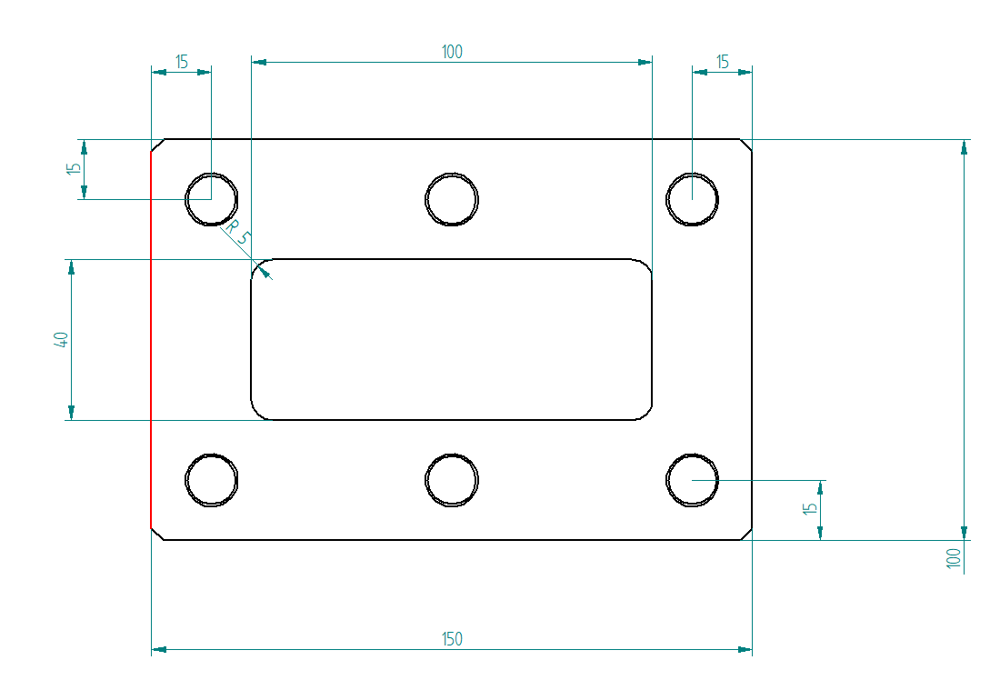

### Modelo 3D de referência

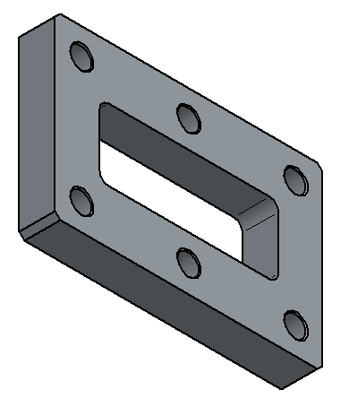

---

## Passos

### 1. Criar uma nova peça

Clique em **New Part**.

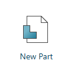

### 2. Selecionar o modo de trabalho

Clique em **Continue with Ordered**.

### 3. Iniciar a extrusão

Clique em **Extrude**.

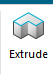

### 4. Selecionar o plano XY

Selecione o plano **XY** para iniciar o esboço.

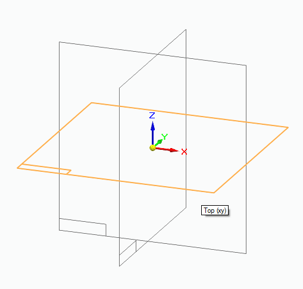

### 5. Criar um retângulo pelo centro

Selecione a ferramenta **Rectangle by Center**.

### 6. Posicionar o retângulo

Clique uma vez na referência central, solte o botão do mouse e arraste para definir o retângulo.

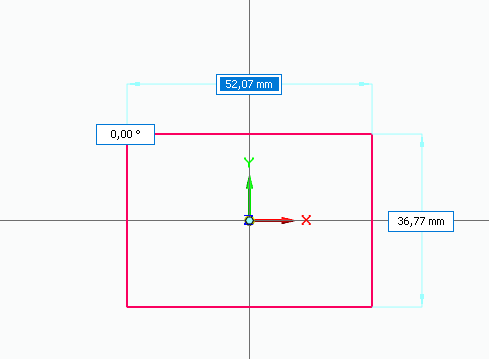

### 7. Definir as dimensões externas

Defina o retângulo com as medidas:

- **150 mm** de largura;
- **100 mm** de altura.

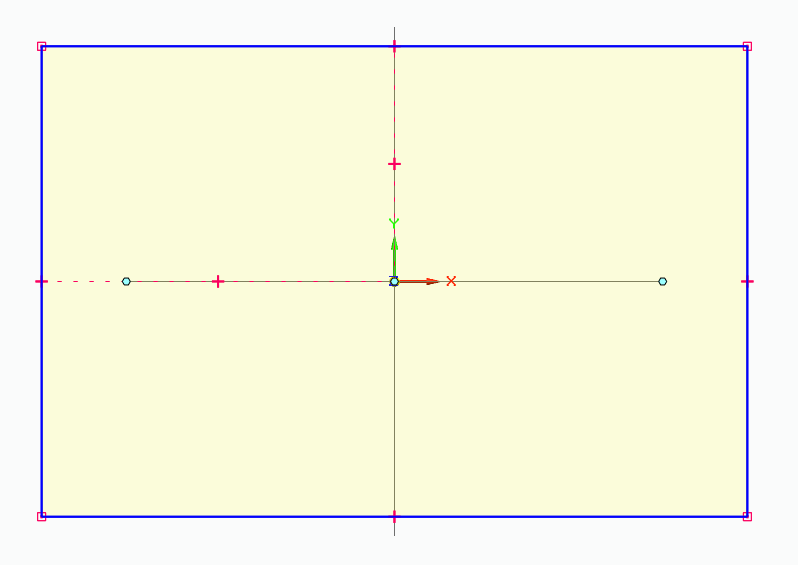

### 8. Aplicar chanfro

Selecione a ferramenta **Chamfer**.

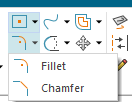

### 9. Configurar o chanfro

Defina as medidas do chanfro conforme a proposta.

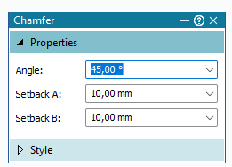

### 10. Selecionar os lados do chanfro

Clique nos dois lados do canto e, em seguida, na linha diagonal indicada pela ferramenta.

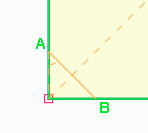

### 11. Chanfrar todos os cantos

Repita o procedimento nos quatro cantos da peça.

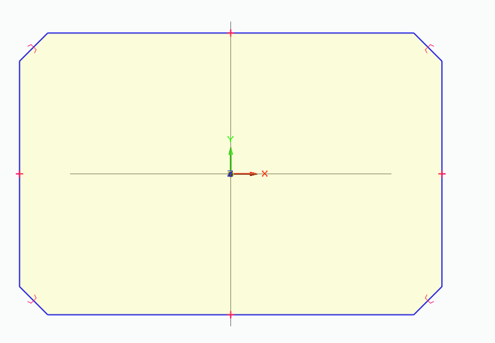

### 12. Criar o retângulo interno

Selecione novamente **Rectangle by Center**.

### 13. Definir o retângulo interno

Adicione um novo retângulo central com as dimensões:

- **100 mm** de largura;
- **40 mm** de altura.

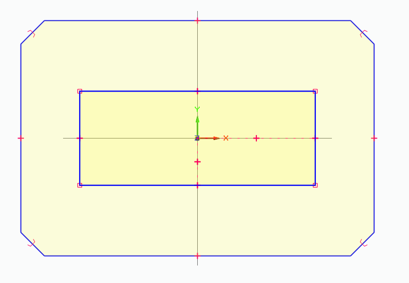

### 14. Aplicar filete

Selecione a ferramenta **Fillet** e configure o raio para **5 mm**.

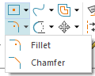

### 15. Filetar todos os cantos internos

Aplique o filete de **5 mm** nos quatro cantos do retângulo interno.

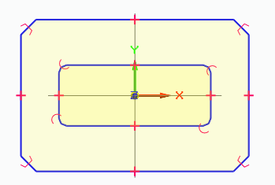

### 16. Finalizar a extrusão

Finalize a extrusão com espessura de **20 mm**.

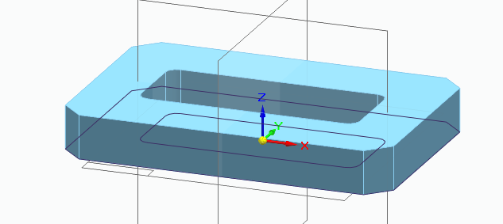

### 17. Iniciar a criação dos furos

Selecione a ferramenta **Hole**.

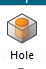

### 18. Selecionar a face da peça

Clique na face frontal da peça para posicionar o furo.

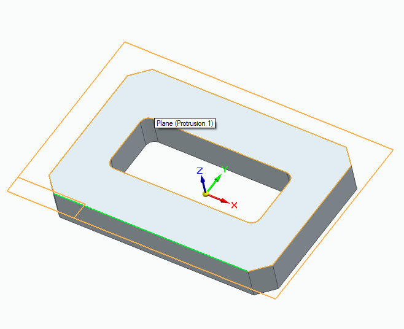

### 19. Criar o primeiro furo

Adicione um furo com:

- **diâmetro de 12 mm**;
- posicionamento de **15 mm x 15 mm** em relação às bordas indicadas.

Finalize o furo.

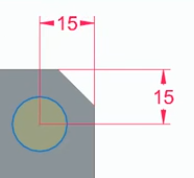

### 20. Iniciar o padrão de furos

Abra **Pattern**, selecione o furo criado e confirme a seleção pelo indicador **Selected**.

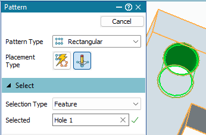

### 21. Selecionar o padrão retangular

Selecione o plano e clique em **Rectangular Pattern**.

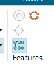

### 22. Definir a direção do padrão

Posicione o mouse no centro do furo, clique e arraste para definir a direção do padrão.

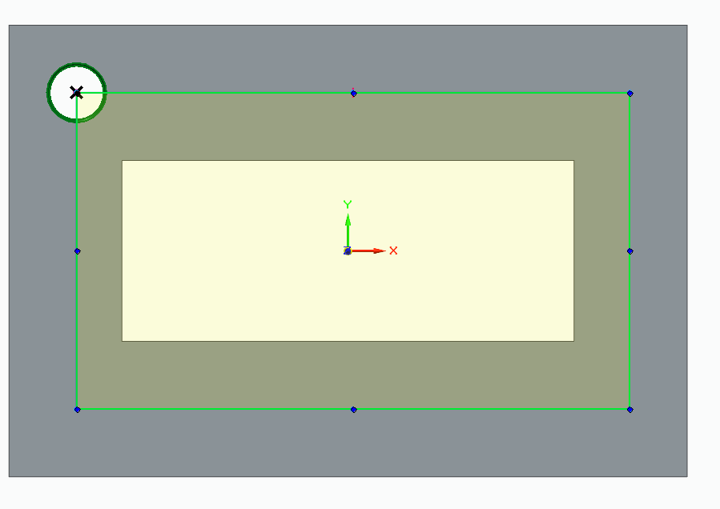

### 23. Definir os afastamentos

Coloque as cotas de **15 mm** em cada lado indicado.

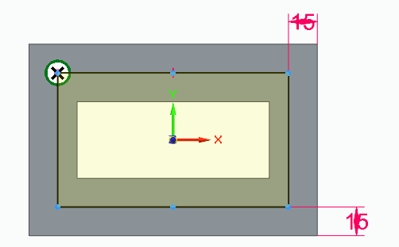

### 24. Definir a quantidade de furos

Configure a quantidade de ocorrências do padrão:

- **X = 3**;
- **Y = 2**.

Conclua o comando.

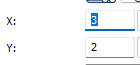

---

## Resultado esperado

Ao final da atividade, a peça deverá apresentar:

- contorno externo de **150 x 100 mm**;
- cantos externos chanfrados;
- abertura interna de **100 x 40 mm** com filetes de **5 mm**;
- espessura de **20 mm**;
- furos de **12 mm** distribuídos por padrão retangular.

