# Atividade 02 — Desenho 2D com projeções ortográficas no Solid Edge

## Criação de desenho técnico a partir de modelo 3D

### Objetivo

Criar o **desenho técnico 2D de uma peça já modelada em 3D**, utilizando o ambiente **Draft** do Solid Edge. Ao final da atividade, o aluno deverá ser capaz de:

- criar uma nova folha de desenho;
- inserir o modelo 3D no ambiente de desenho;
- gerar vistas ortográficas;
- inserir uma vista isométrica;
- organizar as vistas na folha;
- aplicar cotas;
- representar diâmetros e chanfros;
- inserir uma anotação simples;
- conferir a apresentação final do desenho.

---

## Proposta

Partindo da peça desenvolvida nas aulas anteriores, produzir uma folha de desenho técnico semelhante à referência apresentada no vídeo.

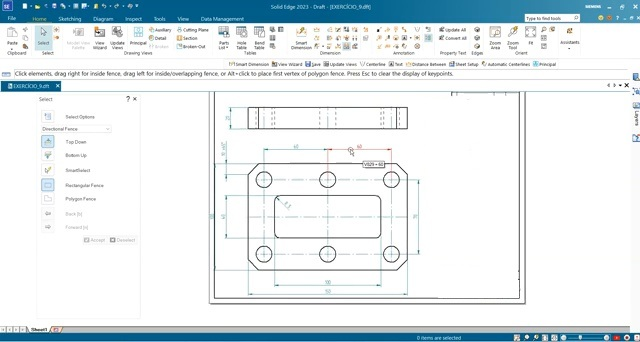

> **Importante:** nesta aula não será criada uma nova peça 3D. O objetivo é utilizar uma peça já modelada para gerar sua documentação técnica em 2D.

---

# Parte 1 – Criando o arquivo de desenho

## 1. Abrir o Solid Edge

1. Inicie o **Solid Edge**.
2. Na tela inicial, localize as opções para criação de novos arquivos.
3. Escolha a opção de criação de um **Draft**.

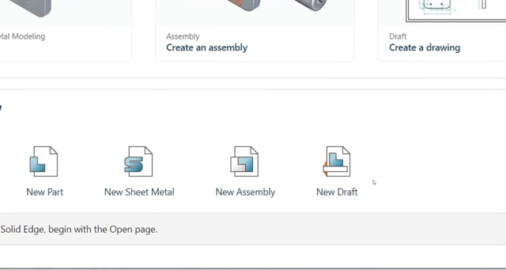

### O que observar

O ambiente **Draft** é utilizado para produzir desenhos técnicos a partir de peças e montagens já modeladas.

---

## 2. Conferir a folha de desenho

Após abrir o Draft:

1. Observe a folha criada pelo Solid Edge.
2. Verifique a orientação da folha e a presença da moldura e do quadro de identificação.
3. Utilize o zoom, se necessário, para visualizar toda a área útil da folha.

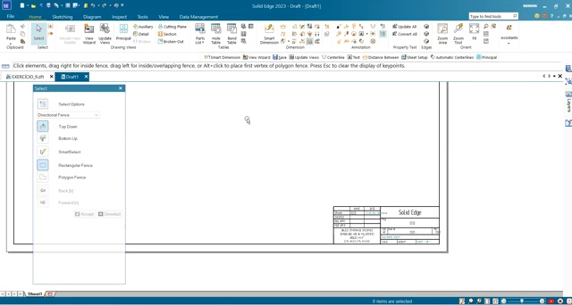

> **Dica:** antes de inserir as vistas, deixe a folha inteira visível. Isso facilita o posicionamento inicial do desenho.

---

# Parte 2 – Inserindo o modelo 3D

## 3. Abrir o comando de criação de vistas

1. Acesse a guia **Home**.
2. Localize o grupo relacionado às **Drawing Views**.
3. Clique em **View Wizard**.

O assistente será aberto para selecionar o modelo que será utilizado no desenho.

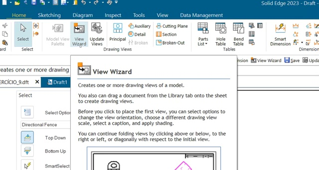

---

## 4. Selecionar a peça

1. No **View Wizard**, localize o arquivo da peça criada anteriormente.
2. Selecione o arquivo.
3. Avance no assistente.
4. Confira a orientação sugerida para a vista principal.
5. Confirme a criação da vista.

> **Atenção:** escolha o arquivo correto da peça. Se o arquivo 3D for alterado posteriormente, o desenho 2D poderá ser atualizado a partir do modelo.

---

# Parte 3 – Criando as projeções ortográficas

## 5. Posicionar a primeira vista

1. Após concluir o assistente, mova o cursor para dentro da folha.
2. Observe a pré-visualização da vista.
3. Posicione-a na região superior da folha.
4. Clique uma vez para confirmar.

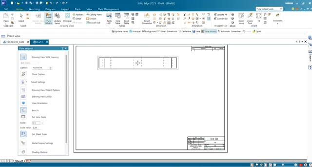

> Não se preocupe ainda com a posição exata. As vistas poderão ser reorganizadas depois.

---

## 6. Criar a vista principal

1. Continue movimentando o cursor a partir da vista já posicionada.
2. Desloque o mouse verticalmente.
3. Observe a projeção ortográfica sendo apresentada.
4. Quando a vista frontal estiver na posição desejada, clique para inseri-la.

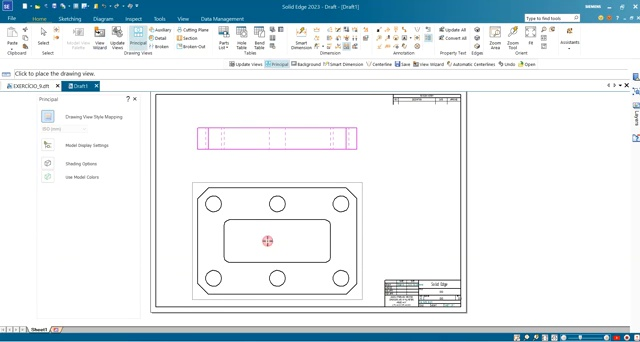

### Resultado esperado

As vistas devem permanecer alinhadas entre si, preservando a correspondência geométrica entre as projeções.

---

## 7. Conferir as projeções

1. Verifique se os furos aparecem corretamente.
2. Observe o rasgo retangular central.
3. Confira os chanfros externos.
4. Verifique se as linhas visíveis e de centro estão coerentes com a geometria da peça.

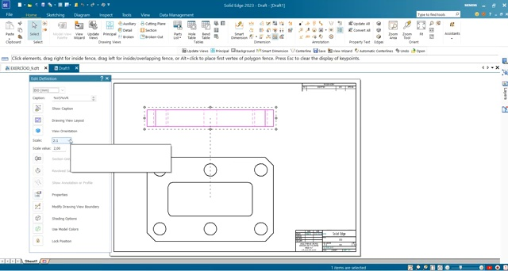

> **Dica:** evite arrastar uma vista projetada de maneira que ela perca o alinhamento lógico com a vista principal.

---

# Parte 4 – Inserindo a vista isométrica

## 8. Criar uma vista isométrica

1. Acesse novamente os comandos de **Drawing Views**.
2. Selecione uma vista isométrica do modelo.
3. Posicione-a à direita das vistas ortográficas.
4. Clique para confirmar.

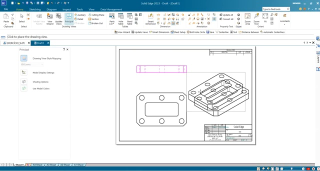

### Por que utilizar a vista isométrica?

Ela facilita a interpretação espacial da peça e ajuda o leitor a relacionar as projeções 2D com a geometria tridimensional.

---

## 9. Organizar as vistas na folha

Reposicione as vistas de modo que:

- a vista superior permaneça na parte superior;
- a vista frontal fique abaixo;
- a vista isométrica permaneça à direita;
- exista espaço suficiente para as cotas;
- nenhuma vista invada a moldura ou o quadro de identificação.

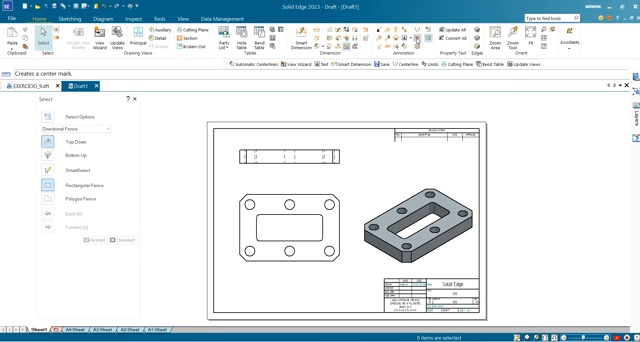

> **Dica:** deixe mais espaço ao redor da vista frontal, pois ela receberá a maior parte das cotas.

> **Dica 2:** Sempre que fizer algum ajuste nas visualizações, clique em 
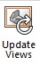

---

# Parte 5 – Inserindo as cotas

## 10. Acessar o comando de dimensionamento

1. Vá até o grupo de comandos de **Dimension**.
2. Utilize o comando **Smart Dimension** quando apropriado.
3. Clique nos elementos geométricos que deseja cotar.
4. Movimente o cursor para fora da peça.
5. Clique novamente para posicionar a cota.

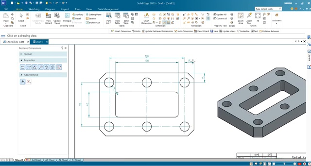

---

## 11. Inserir as dimensões principais

Insira as dimensões necessárias para definir a peça, como:

- largura total;
- altura total;
- dimensões do rasgo interno;
- posicionamento dos furos;
- distâncias entre centros;
- diâmetro dos furos;
- dimensões dos chanfros.

> **Importante:** o objetivo não é repetir cotas desnecessariamente. Uma boa cotagem deve definir a peça sem criar informações redundantes.

---

## 12. Posicionar corretamente as cotas

Ao inserir cada dimensão:

1. Selecione os elementos correspondentes.
2. Arraste a cota para fora do contorno da peça.
3. Mantenha um espaçamento visual adequado entre cotas consecutivas.
4. Evite cruzar linhas de cota sempre que possível.
5. Confirme com um clique.

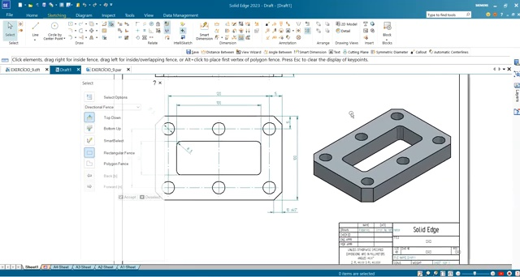

---

# Parte 6 – Ajustando a apresentação das cotas

## 13. Editar uma cota

Quando necessário:

1. Clique sobre a cota já inserida.
2. Observe o painel de propriedades.
3. Verifique as opções de **Format** e **Properties**.
4. Faça os ajustes necessários para a representação técnica.

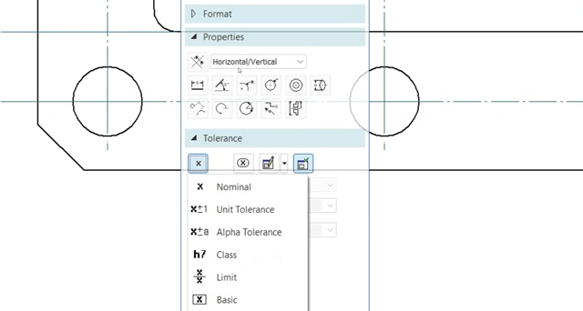

### Exemplos de ajustes

Dependendo do elemento selecionado, podem ser configurados:

- formato da dimensão;
- prefixos;
- símbolo de diâmetro;
- tolerância;
- quantidade de casas decimais;
- apresentação da linha e do texto.

---

## 14. Cotar o chanfro

Para representar um chanfro:

1. Aproxime o zoom da região chanfrada.
2. Selecione a geometria correspondente.
3. Insira a dimensão.
4. Verifique se a indicação representa corretamente o comprimento e o ângulo do chanfro.
5. Posicione o texto em uma região de fácil leitura.

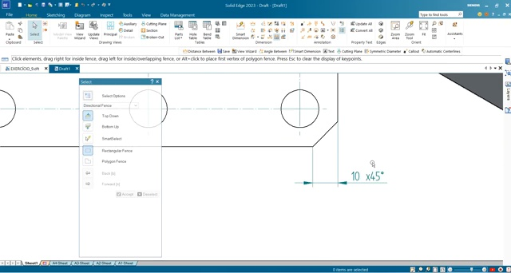

> No exemplo do vídeo, a representação do chanfro utiliza o formato **comprimento × ângulo**, como `10 × 45°`.

---

# Parte 7 – Inserindo uma anotação

## 15. Adicionar texto ao desenho

1. Acesse o comando de texto/anotação.

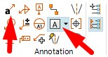

2. Clique no local onde deseja inserir a informação.
3. Digite o texto desejado.
4. Confirme a edição.
5. Reposicione o texto se necessário.

No vídeo é inserida uma anotação simples para demonstrar o recurso.

> Utilize anotações apenas quando elas acrescentarem uma informação útil ao desenho técnico.

---

# Parte 8 – Conferência final

## 16. Revisar a folha

Antes de salvar, confira se:

- [ ] o modelo correto foi utilizado;
- [ ] as projeções ortográficas estão alinhadas;
- [ ] a vista isométrica está bem posicionada;
- [ ] as vistas não se sobrepõem;
- [ ] todas as dimensões necessárias foram inseridas;
- [ ] as cotas estão legíveis;
- [ ] o diâmetro dos furos está representado adequadamente;
- [ ] o chanfro está indicado corretamente;
- [ ] não existem cotas duplicadas;
- [ ] o desenho está dentro da área útil da folha.

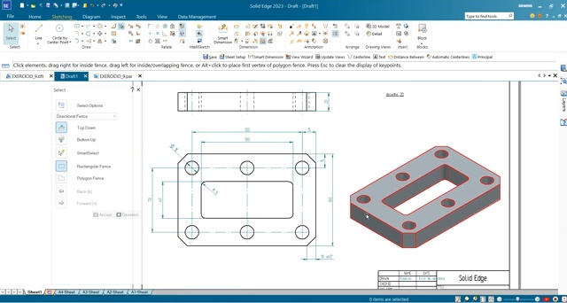

---

# Resultado esperado

Ao final da atividade, a folha deverá apresentar:

1. **vista superior**;
2. **vista frontal/principal**;
3. **vista isométrica**;
4. **cotas de fabricação**;
5. **indicações de diâmetro e chanfro**;
6. organização compatível com uma folha de desenho técnico.

---

