# Atividade 03 — Rosca métrica interna no Solid Edge

## Furos roscados em bloco mecânico

### Objetivo
Modelar um bloco mecânico e aplicar **furos roscados métricos internos** utilizando o comando **Hole** do Solid Edge.

Ao final da atividade, o aluno deverá ser capaz de:

- criar um sólido a partir de um esboço retangular;
- realizar uma extrusão com dimensões definidas;
- criar um furo passante central;
- configurar um furo roscado no padrão **ISO Metric**;
- posicionar furos por meio de cotas;
- aplicar chanfros nas extremidades da peça.

---

## Proposta

A peça final é um bloco retangular com um **furo passante central**, dois **furos roscados M12** na face superior e chanfros nas extremidades.

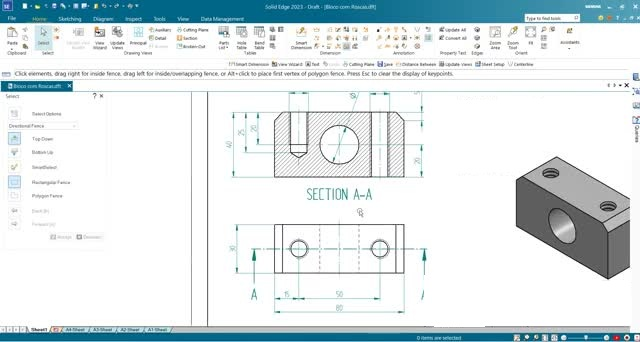

### Dimensões principais observadas no exercício

| Elemento | Dimensão / configuração |
|---|---:|
| Comprimento do bloco | 80 mm |
| Largura do bloco | 30 mm |
| Altura do bloco | 40 mm |
| Distância entre os centros dos furos superiores | 50 mm |
| Distância do centro de cada furo à extremidade | 15 mm |
| Furo central | Ø 24 mm |
| Rosca superior | M12 |
| Passo da rosca | 1,75 mm |
| Diâmetro interno indicado pelo Solid Edge | aproximadamente 10,106 mm |
| Profundidade do furo roscado | 25 mm |
| Chanfro nas extremidades | 5 mm |

> **Observação:** os valores acima foram organizados a partir das cotas e configurações apresentadas no vídeo. Durante a atividade, confira as dimensões exibidas na tela antes de confirmar cada operação.

---

# Passo a passo

## 1. Criar uma nova peça

1. Abra o **Solid Edge**.
2. Crie um novo arquivo do tipo **Part**.
3. Trabalhe no ambiente **Ordered**.
4. Salve o arquivo antes de iniciar a modelagem.

> **Dica:** utilizar nomes como `Bloco_Rosca_Metrica.par` facilita a identificação do exercício.

---

## 2. Criar o esboço da base

1. Inicie uma nova **Protrusion / Extrude**.
2. Selecione um plano de referência adequado para o esboço.
3. Escolha o comando **Rectangle**.
4. Desenhe o retângulo tomando a origem como referência.
5. Insira as cotas do retângulo:
   - **80 mm** no comprimento;
   - **30 mm** na largura.
6. Confira se o esboço está corretamente restringido.
7. Finalize o esboço.

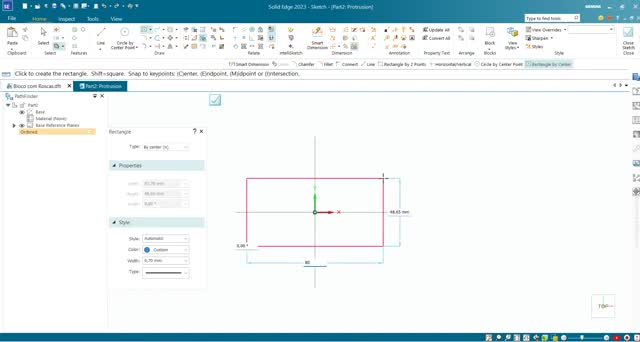

> **Atenção:** evite definir as medidas apenas arrastando o mouse. Sempre informe os valores usando as cotas do esboço.

---

## 3. Extrudar o bloco

1. Com o perfil retangular concluído, avance para a extrusão.
2. Informe a altura de **40 mm**.
3. Verifique o sentido da extrusão.
4. Confirme a operação.

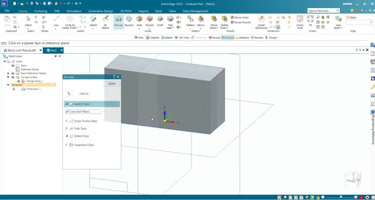

Ao final desta etapa, você deverá ter um bloco retangular sólido.

---

## 4. Criar o furo passante central

1. Na guia **Home**, selecione o comando **Hole**.
2. Clique na face frontal do bloco.
3. Abra as opções do furo.
4. Utilize o padrão **ISO Metric**.
5. Configure o diâmetro do furo para **24 mm**.
6. Defina o furo como passante pela peça.
7. Confirme as configurações.

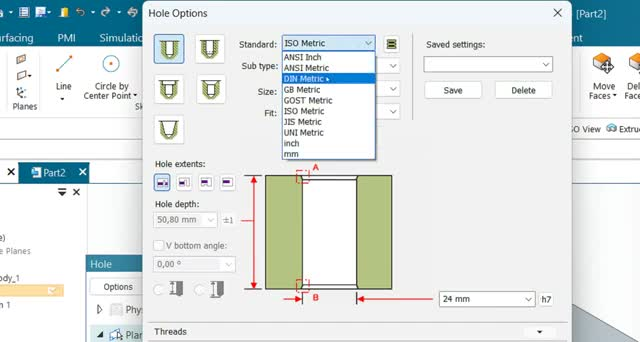

### Posicionar o furo

1. Clique aproximadamente no centro da face frontal.
2. Utilize as referências geométricas ou cotas para centralizar o furo.
3. Confirme a posição.

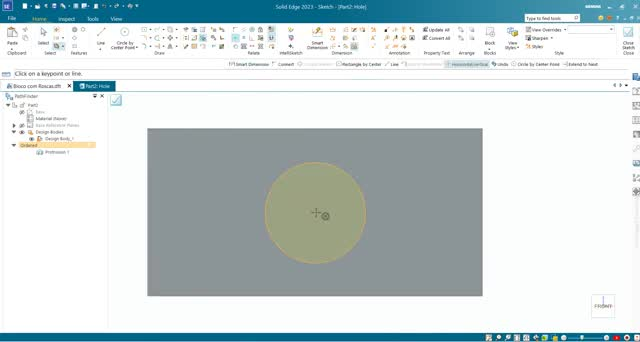

Após concluir, confira o resultado:

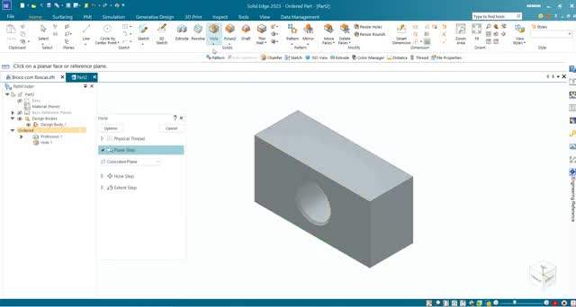

> **Verificação:** o furo deve atravessar completamente o bloco e ficar centralizado na face frontal.

---

## 5. Configurar o primeiro furo roscado M12

1. Selecione novamente **Hole**.
2. Clique na **face superior** do bloco.
3. Abra **Hole Options**.
4. Selecione o padrão **ISO Metric**.
5. Escolha o tipo de furo com **rosca interna**.
6. Configure a rosca como **M12**.
7. Confira os parâmetros mostrados pelo software:
   - diâmetro nominal: **12 mm**;
   - diâmetro interno: aproximadamente **10,106 mm**;
   - passo: **1,75 mm**;
   - profundidade do furo: **25 mm**.
   - extensão da rosca (Finite Extend): **20 mm**
8. Confira também o sentido e a extensão da rosca.
9. Confirme as opções do furo.

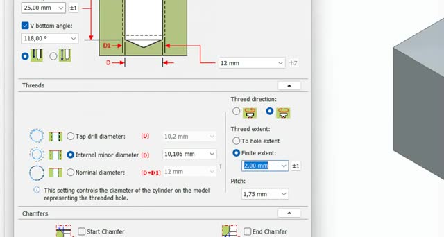

> **Importante:** não confunda o diâmetro nominal da rosca (**M12**) com o diâmetro do furo utilizado antes da formação da rosca.

---

## 6. Posicionar o primeiro furo roscado

1. Posicione o ponto do furo aproximadamente na região da primeira extremidade.
2. Utilize **Smart Dimension** para definir sua posição.
3. Informe **15 mm** entre o centro do furo e a extremidade longitudinal da peça.
4. Centralize o furo na largura do bloco.
5. Confirme a posição.

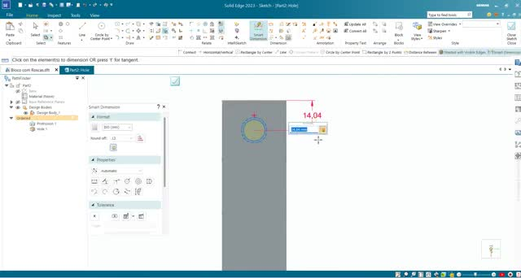

Conclua o comando **Hole** e verifique o resultado.

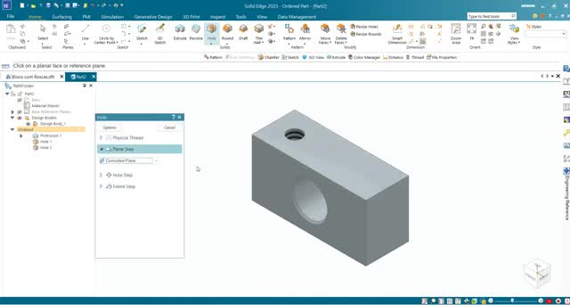

---

## 7. Criar o segundo furo roscado

1. Inicie novamente o comando **Hole** ou repita a configuração utilizada anteriormente.
2. Mantenha os mesmos parâmetros da rosca **M12**.
3. Posicione o segundo furo próximo à extremidade oposta.
4. Utilize as cotas para definir sua posição.
5. Mantenha **15 mm** entre o centro do furo e a extremidade da peça.
6. Verifique se a distância entre os centros dos dois furos é **50 mm**.
7. Centralize também esse furo na largura do bloco.
8. Confirme a operação.

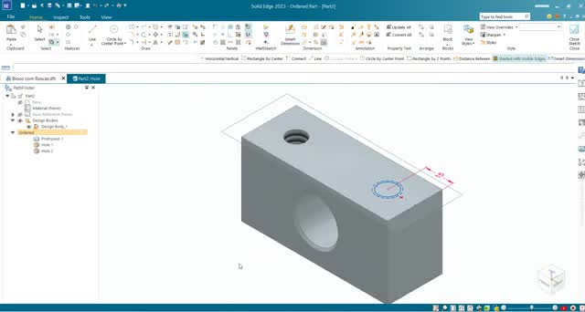

Ao concluir, a face superior deverá apresentar dois furos roscados:

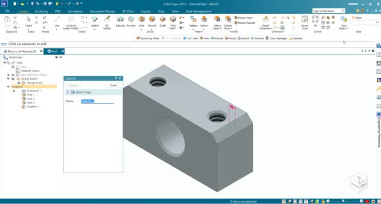

---

## 8. Aplicar os chanfros

1. Selecione o comando **Chamfer**.
2. Clique na aresta vertical da primeira extremidade do bloco.
3. Informe **5 mm** para o chanfro.
4. Confirme a operação.
5. Repita o procedimento na extremidade oposta.

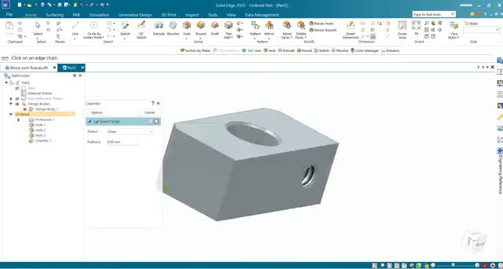

> **Dica:** antes de concluir, gire a peça para verificar se somente as arestas desejadas foram selecionadas.

---

# Resultado esperado

A peça final deverá apresentar:

- bloco com dimensões aproximadas de **80 × 30 × 40 mm**;
- um furo passante central de **Ø 24 mm**;
- dois furos roscados **M12** na face superior;
- centros dos furos superiores afastados **50 mm**;
- furos posicionados a **15 mm** das extremidades;
- chanfros de **5 mm** nas extremidades.

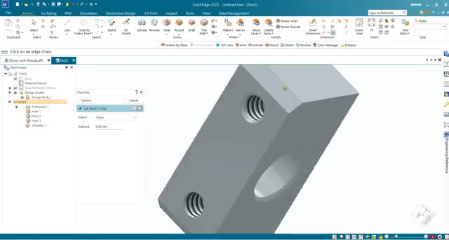

---

# Checklist antes de finalizar

- [ ] O bloco foi criado com as dimensões corretas.
- [ ] O furo central está passante e centralizado.
- [ ] Os dois furos superiores estão configurados como rosca métrica interna M12.
- [ ] A profundidade dos furos roscados foi conferida.
- [ ] Os furos estão posicionados simetricamente.
- [ ] Os chanfros foram aplicados nas extremidades corretas.
- [ ] A peça foi salva.

---

