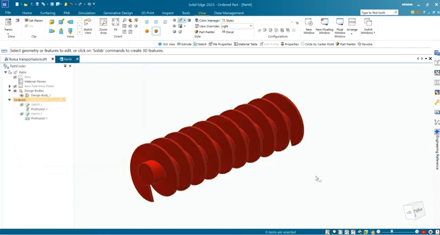
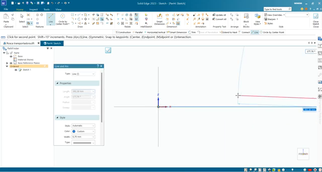
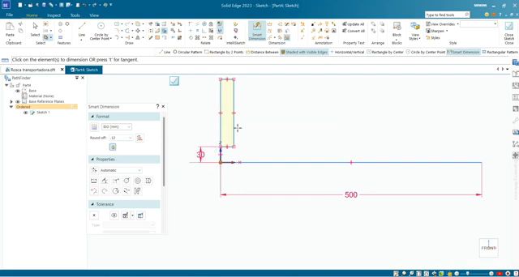
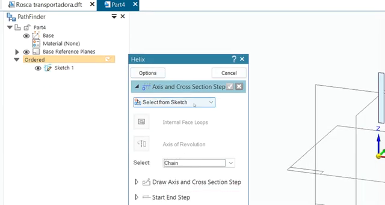
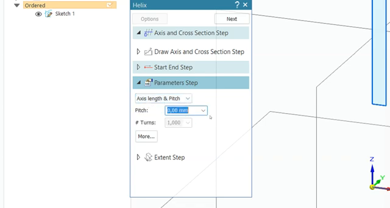
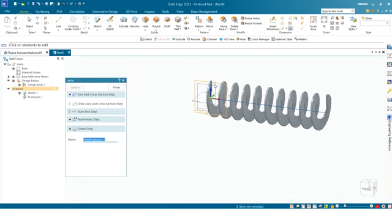
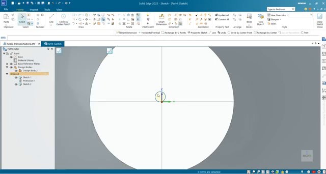
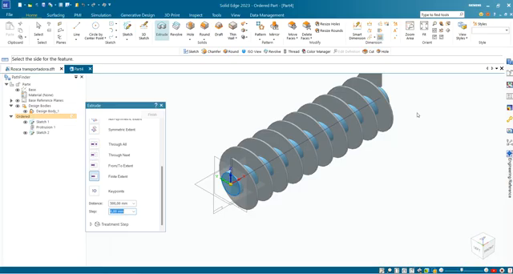

# Atividade 04 — Modelagem de rosca transportadora por hélice

**Disciplina:** Desenho Assistido por Computador (DAC)  
**Software:** Solid Edge — ambiente **Part**, modelagem **Ordered**  
**Unidade:** Modelagem tridimensional de componentes mecânicos  
**Arquivo de trabalho:** `DAC_R12_Rosca_Transportadora.par`  
**Unidade dimensional:** milímetro (mm)

## 1. Objetivo

Construir uma **rosca transportadora helicoidal** a partir de um perfil retangular e de um eixo de referência, utilizando **Sketch**, **Smart Dimension**, **Helix** e uma operação adicional de **Extrude**. Ao concluir, o estudante deverá ser capaz de interpretar os parâmetros da hélice, reconhecer o histórico de operações no **PathFinder**, controlar as cotas do perfil e inspecionar a geometria final.

## 2. Proposta de modelagem

Modelar uma **espira helicoidal de seção retangular**, com comprimento axial de referência de **500 mm**, e posteriormente um **eixo cilíndrico concêntrico**. A espira deverá apresentar avanço axial uniforme em cada volta e ser visualizada em vista isométrica.

### 2.1 Tabela de dimensões e parâmetros

| Identificação | Descrição | Valor | Situação |
|:--|:--|--:|:--|
| L | Comprimento axial de referência | **500 mm** | Cota identificável no vídeo |
| P | Passo axial da hélice | **50 mm** | **Valor adotado para a prática**; não confirmado no vídeo |
| N | Número teórico de voltas (`L/P`) | **10** | Calculado com os valores da prática |
| t | Espessura axial do perfil retangular | **5 mm** | **Valor didático proposto** |
| h | Altura radial do perfil retangular | **40 mm** | **Valor didático proposto** |
| De | Diâmetro externo da espira | **100 mm** | **Valor didático proposto** |
| d | Diâmetro nominal do eixo cilíndrico | **20 mm** | **Valor didático proposto** |
| Modo | Método de parametrização | **Axis Length & Pitch** | Identificável no painel Helix |

### 2.2 Comandos e localização na interface

| Comando | Localização operacional no Solid Edge | Função |
|:--|:--|:--|
| **New** | Tela inicial ou menu **File → New** | Criar o documento **Part** |
| **Sketch** | Ambiente **Part**, faixa de opções **Home**, grupo de esboços | Iniciar o esboço num plano de referência |
| **Line** | Dentro de **Sketch**, guia **Home → Draw** | Desenhar o eixo geométrico de referência |
| **Rectangle** | Dentro de **Sketch**, guia **Home → Draw** | Criar a seção transversal fechada |
| **Smart Dimension** | Dentro de **Sketch**, guia **Home → Dimension** | Aplicar cotas controladoras |
| **Finish** | Barra de comandos ativa / botão de confirmação | Encerrar a operação em andamento |
| **Helix** | Ambiente **Part / Ordered**, **Home**, grupo de recursos sólidos; pode estar em menu expansível conforme a versão | Construir a espira helicoidal |
| **Circle by Center Point** | **Sketch → Home → Draw** | Criar o perfil circular do eixo |
| **Extrude** | **Part → Home**, ferramentas de sólidos | Gerar o eixo cilíndrico |
| **PathFinder** | Painel lateral esquerdo | Inspecionar o histórico de recursos |
| **Fit / View Cube** | Controles de visualização na área gráfica | Enquadrar e orientar a peça |

## 3. Procedimento experimental

### Etapa 1 — Inicialização do arquivo

1. Abra o **Solid Edge**.
2. Clique em **File → New** e selecione o modelo **ISO Metric Part** (ou equivalente métrico de **Part**).
3. No **PathFinder**, confirme que o modo de modelagem é **Ordered**. Não utilize **Assembly** ou **Draft**.
4. Verifique as unidades em **mm** nas propriedades do documento.
5. Selecione **File → Save As**, informe `DAC_R12_Rosca_Transportadora.par` e confirme.

**Registro visual:**

**Verificação:** documento `.par` aberto, com planos de referência disponíveis e histórico Ordered.

### Etapa 2 — Esboço do eixo e da seção retangular

1. Clique em **Sketch** (**Part → Home**) e selecione um **Base Reference Plane** adequado, mantendo a futura direção axial horizontal na tela.
2. Em **Sketch → Home → Draw → Line**, clique na **origem**, desloque o cursor horizontalmente à direita e clique no ponto final. Aplique a relação **Horizontal**, se ela não for reconhecida automaticamente.
3. Clique em **Smart Dimension** (**Sketch → Home → Dimension**), selecione a linha e digite **500 mm**; pressione **Enter**.
4. Clique em **Rectangle** (**Sketch → Home → Draw**) e desenhe um **retângulo fechado**, junto à extremidade inicial da linha, posicionado do lado radial da linha de eixo. **Não desenhe o retângulo atravessando o eixo.**
5. Aplique **Smart Dimension** para definir, na configuração didática com eixo: espessura axial **5 mm**, altura radial **40 mm** e distância do eixo geométrico à borda interna da seção **10 mm**.
6. Use as relações **Horizontal**, **Vertical** e **Coincident** quando pertinentes; posicione a seção de forma que sua face inicial coincida com a extremidade de referência do comprimento axial.
7. Confirme que o retângulo forma **uma região fechada** e que a linha axial permanece um elemento de referência **separado** do contorno. Clique em **Finish**.

**Observação técnica:** uma linha de eixo não é uma borda do perfil; misturar elementos de referência com contornos fechados pode impedir a seleção do perfil no comando Helix.

### Etapa 3 — Definir o perfil e o eixo em Helix

1. Retorne ao ambiente **Part / Ordered**.
2. Na **Ribbon Bar → Home → recursos sólidos**, abra o menu que contém **Helix** e clique no comando (na gravação, ele é apresentado no painel **Helix**).
3. No painel **Helix**, identifique a etapa **Axis and Cross Section Step**.
4. No seletor de esboço, escolha **Select from Sketch** e indique o esboço produzido na etapa anterior.
5. Quando solicitado, selecione a **região fechada retangular** para a seção transversal e a **linha de 500 mm** para o eixo de hélice. A sequência de seleção pode ser indicada pelo painel e pelos prompts do software.
6. Verifique a prévia e clique em **Next** para avançar.

**Se falhar:** retorne à seleção; confira se o retângulo está fechado, se a linha axial é independente e se não foi selecionada uma face inadequada.

### Etapa 4 — Configuração paramétrica da hélice

1. Abra a etapa **Parameters Step** no painel **Helix**.
2. No método de definição, escolha **Axis Length & Pitch**.
3. No campo **Pitch**, digite **50 mm** (*parâmetro da atividade, não cota confirmada do vídeo*).
4. Verifique que a linha que controla **Axis Length** corresponde a **500 mm**.
5. Examine o sentido de rotação e as etapas **Start End Step** e **Extent Step**. Se necessário, inverta o sentido para que a espira avance ao longo da linha axial.
6. Observe a pré-visualização. Espiras regulares e espaçadas uniformemente indicam um passo constante.
7. Clique em **Finish** somente após conferir o resultado.

**Rigor dimensional:** **Pitch** é a distância axial percorrida por uma volta completa da hélice; não é espessura da chapa nem distância medida sobre a aresta inclinada da espira.

### Etapa 5 — Construção do eixo central

1. Oriente a vista para observar uma seção perpendicular ao eixo helicoidal, utilizando **View Cube**.
2. Selecione um plano apropriado para o novo perfil e clique em **Sketch**.
3. Clique em **Circle by Center Point** (**Sketch → Home → Draw**). Posicione o centro **coincidente com o eixo da hélice**.
4. Clique em **Smart Dimension** e aplique **diâmetro Ø20 mm** ao círculo (valor didático).
5. Conclua o Sketch com **Finish**.
6. Clique em **Extrude** (**Part → Home**), selecione a região circular e defina extensão axial de **500 mm**, na direção do corpo helicoidal.
7. Certifique-se de que a operação está configurada como **adição de material**. Inspecione a união geométrica entre eixo e espira; se houver falha de união, ajuste a interface de contato do perfil e reconstrua a operação.
8. Confirme em **Finish**.

**Importante:** o **diâmetro nominal do eixo** (Ø20 mm) refere-se à geometria cilíndrica modelada. Ele não equivale ao diâmetro de um **Hole**. Um furo exige definição independente de geometria, dimensões e eventual folga de montagem; nesta atividade, **não há criação de furo**.

### Etapa 6 — Inspeção e gravação

1. No **PathFinder**, localize o recurso **Helix** e a operação de **Extrude** do eixo.
2. Clique no **View Cube** para estabelecer a **vista isométrica**.
3. Utilize **Fit** para enquadrar a peça inteira.
4. Gire o modelo e confira a concentricidade, a continuidade da espira e a uniformidade do passo.
5. Opcionalmente, altere a **aparência visual** do modelo; isso não modifica as cotas.
6. Salve o arquivo com **Ctrl+S** e faça uma captura de tela mostrando a peça e o **PathFinder**.

 

## 4. Resultado esperado

O arquivo `.par` deverá conter um sólido de geometria helicoidal com seção retangular, distribuído regularmente por um comprimento axial de referência de **500 mm**, e um eixo central concêntrico. Na atividade parametrizada com **passo de 50 mm**, a relação `N = 500/50` indica **10 revoluções teóricas**. A forma das pontas pode variar segundo as condições de terminação escolhidas em **Helix**.

## 5. Checklist de verificação

- [ ] Arquivo criado no ambiente **Part / Ordered** e salvo como `.par`.
- [ ] Linha axial horizontal com **500 mm**, devidamente cotada.
- [ ] Perfil retangular **fechado**, posicionado radialmente em relação ao eixo.
- [ ] Relações geométricas e cotas do Sketch verificadas.
- [ ] Comando **Helix** configurado usando **Axis Length & Pitch**.
- [ ] Espira com sentido e passo constantes, sem falhas geométricas.
- [ ] Eixo central concêntrico, criado com **Circle by Center Point** e **Extrude**.
- [ ] Operações verificadas no **PathFinder**.
- [ ] Peça apresentada integralmente em vista isométrica.
- [ ] Arquivo salvo e captura final registrada.

