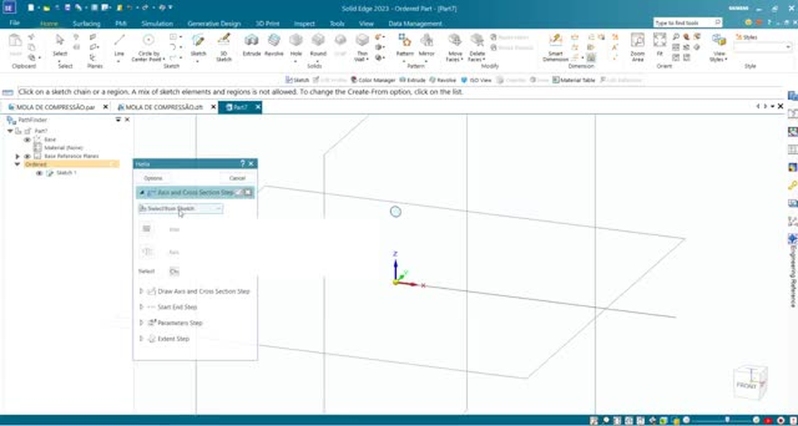
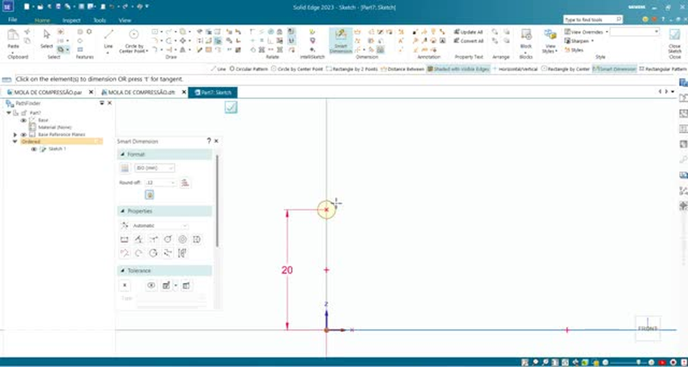
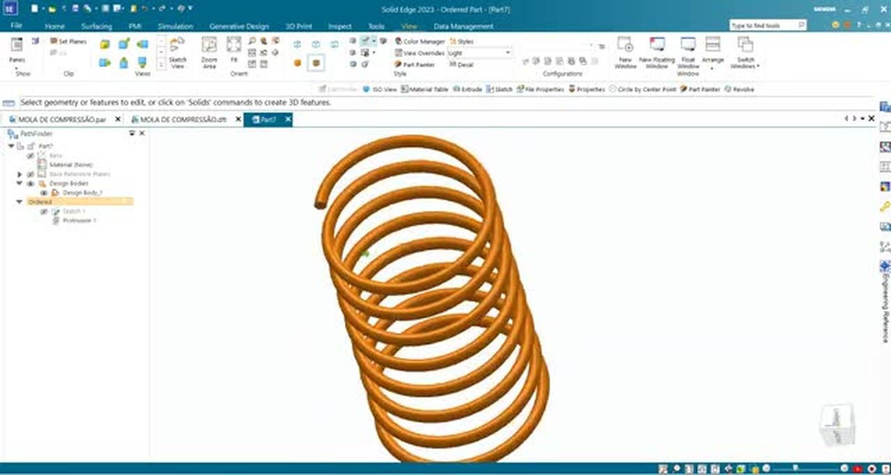
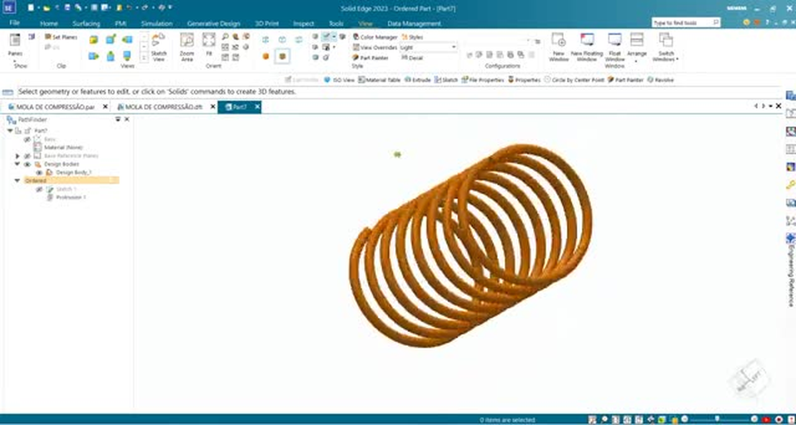

# Atividade 05 — Modelagem de mola de compressão no Solid Edge

**Disciplina:** Desenho Assistido por Computador (DAC)  
**Software:** Solid Edge 
**Ambiente:** **Part**  
**Modalidade:** **Ordered**  
**Tema:** Construção de uma mola helicoidal de compressão com o comando **Helix**

---

## 1. Objetivo

Ao final desta atividade, o aluno deverá ser capaz de:

- Criar um arquivo no ambiente **Part**, na modalidade **Ordered**.
- Elaborar e dimensionar esboços bidimensionais com **Sketch**, **Line**, **Circle by Center Point** e **Smart Dimension**.
- Distinguir o diâmetro do arame, o diâmetro médio e os diâmetros externo e interno da mola.
- Utilizar o comando **Helix** para criar uma geometria helicoidal sólida.
- Configurar eixo, seção transversal, passo, número de espiras e extensão axial.
- Inspecionar o modelo e identificar suas operações no **PathFinder**.
- Salvar o componente no formato nativo **.par**.

---

## 2. Proposta da atividade

Modelar uma **mola helicoidal de compressão**, formada por um arame de seção transversal circular, utilizando um eixo de referência e o recurso **Helix** do Solid Edge.

### 2.1. Tabela de dimensões e configurações

| Parâmetro | Símbolo | Valor / configuração | Observação |
|---|---|---|---|
| Comprimento axial de referência | `L` | **80 mm** | Cota do segmento usado como referência axial |
| Diâmetro do arame | `d` | **3 mm** | Diâmetro do perfil circular |
| Distância do eixo ao centro do arame | `R` | **20 mm** | Conferir no esboço a função desta cota |
| Diâmetro médio da mola | `Dm` | **40 mm** | Calculado como `2R`, se `R = 20 mm` for o raio médio |
| Diâmetro externo | `De` | **43 mm** | Calculado como `Dm + d` |
| Diâmetro interno | `Di` | **37 mm** | Calculado como `Dm - d` |
| Número de espiras | `N` | **/painel Helix** | Não atribuir valor não confirmado |
| Passo da hélice | `P` | **painel Helix** | Não atribuir valor não confirmado |
| Ambiente de modelagem | — | **Part / Ordered** | Construção sequencial das operações |
| Operação de sólido | — | **Helix** | Geração do volume helicoidal |

**Nota dimensional:** Os valores `Dm = 40 mm`, `De = 43 mm` e `Di = 37 mm` são *derivados*, e não cotas independentes, somente se os **20 mm** representarem efetivamente a distância radial entre o eixo da hélice e o centro do arame. Não tratar esses valores como dimensões diretamente confirmadas na interface sem verificar o esboço.

---

## 3. Procedimento de modelagem

### Etapa 1 — Criar o documento de peça

1. Abra o **Solid Edge**.
2. Acesse **File > New**.
3. Selecione o modelo de documento **ISO Part** com unidades em milímetros.
4. Confirme a criação do documento.
5. Verifique se a modalidade ativa é **Ordered**.
6. Identifique os planos de referência e a árvore **PathFinder**.

**Verificação:** a área gráfica deve estar vazia e o **PathFinder** deve mostrar a estrutura inicial da peça.

### Etapa 2 — Desenhar o eixo axial de referência

1. Na **Ribbon Bar**, acesse **Home > Sketch > Sketch**.
2. Selecione um plano de referência que contenha a direção desejada para o eixo da mola.
3. No ambiente de esboço, acione **Line**.
4. Clique na origem como ponto inicial do segmento.
5. Trace a linha ao longo da direção horizontal de referência.
6. Acione **Smart Dimension**.
7. Selecione a linha e informe **80 mm**.
8. Confirme a dimensão e conclua a edição do esboço.

### Etapa 3 — Criar o perfil circular do arame

1. Inicie ou edite o **Sketch** destinado à seção transversal da hélice.
2. Na guia de desenho do esboço, acione **Circle by Center Point**.
3. Posicione o centro do círculo afastado do eixo longitudinal.
4. Clique para definir o centro e clique novamente para concluir a circunferência.
5. Acione **Smart Dimension** e selecione a circunferência.
6. Informe o diâmetro **Ø 3 mm**.
7. Dimensione a distância do eixo ao centro da circunferência conforme o exercício; considere **20 mm** apenas se essa for a cota radial mostrada na construção.
8. Confirme as cotas.

**Explicação técnica:** **Ø 3 mm** é o diâmetro do arame. A distância entre o eixo e o centro do perfil define o raio médio da mola. Essas medidas não são intercambiáveis.

> **Captura de tela:** esboço contendo o eixo, o perfil circular de **Ø 3 mm** e sua cota de posicionamento.

### Etapa 4 — Conferir as restrições geométricas

1. Verifique o alinhamento do eixo com a direção de referência.
2. Confirme a posição do centro do círculo em relação ao eixo.
3. Verifique a dimensão **Ø 3 mm**.
4. Certifique-se de que não existem relações geométricas conflitantes ou cotas redundantes.
5. Finalize o **Sketch**.

**Explicação técnica:** dimensões e relações geométricas devem impedir deslocamentos acidentais do perfil. Uma alteração no diâmetro do arame não deve modificar a distância do centro do perfil ao eixo, a menos que essa dependência tenha sido prevista.

> **Captura de tela:** esboço dimensionado com relações geométricas visíveis.

### Etapa 5 — Acionar o comando Helix

1. Retorne à área tridimensional do ambiente **Part**.
2. Na Ribbon Bar, acesse **Home > Solids > Helix**; expanda o menu do grupo, se necessário.
3. Observe o painel de orientação da operação.
4. Identifique os estágios de definição de eixo e seção, parâmetros e extensão.

**Explicação técnica:** **Helix** gera um sólido com seção transversal transportada ao longo de uma trajetória helicoidal, diferentemente de uma **Protrusion** linear convencional.

### Etapa 6 — Selecionar o eixo e a seção transversal

1. Na etapa de definição de geometria do **Helix**, escolha o esboço correspondente.
2. Selecione a linha que representa o eixo longitudinal da mola.
3. Selecione o perfil circular de **Ø 3 mm** como seção transversal.
4. Confirme a seleção conforme as solicitações do painel.
5. Avance para a próxima etapa do comando.

**Verificação:** a seção circular deve estar afastada do eixo; o eixo determina a direção e a posição da trajetória helicoidal.

> **Captura de tela:** eixo e perfil circular destacados durante a seleção no comando **Helix**.

### Etapa 7 — Configurar os parâmetros da hélice

1. Avance até **Parameters Step**.
2. Identifique o método de definição da hélice apresentado na interface.
3. Configure os campos solicitados pelo método escolhido.
4. Confira o **passo (`P`)**, a **quantidade de voltas (`N`)** e o **comprimento axial (`L`)** conforme a configuração efetivamente utilizada.
5. Verifique o sentido de rotação.
6. Examine a pré-visualização antes de confirmar.

| Método de parametrização | Grandezas informadas | Grandeza calculada |
|---|---|---|
| **Axis Length & Pitch** | Comprimento axial e passo | Número de voltas |
| **Axis Length & Turns** | Comprimento axial e número de voltas | Passo |
| **Pitch & Turns** | Passo e número de voltas | Comprimento axial |

**Exemplo apenas para compreensão:** se o comprimento axial for **80 mm** e forem definidas **10 voltas**, então `P = 80 / 10 = 8 mm/volta`. 

**Explicação técnica:** o **passo** corresponde ao avanço axial obtido após uma volta completa. Diminuir o passo aproxima as espiras; aumentá-lo as afasta.

### Etapa 8 — Finalizar a operação

1. Confirme o eixo selecionado.
2. Confirme a seção circular **Ø 3 mm**.
3. Confira os parâmetros de passo, número de voltas e extensão.
4. Verifique se a pré-visualização mostra uma hélice contínua.
5. Clique em **Finish** para concluir a operação.
6. Inspecione o sólido gerado.

**Resultado intermediário:** o Solid Edge deverá apresentar uma mola helicoidal sólida, com seção circular constante.

