# Atividade 06 — Modelagem de tubo curvado por varredura

**Disciplina:** Desenho Assistido por Computador (DAC)  
**Software:** Solid Edge (procedimento validado no Solid Edge 2026, interface em inglês)  
**Ambiente:** Part — modelagem **Ordered**  
**Tema:** trajetória com arco tangente, plano normal à curva, **Swept Protrusion** e **Swept Cutout**

## 1. Objetivo

Modelar um tubo curvado a 90° a partir de uma trajetória plana e de seções circulares, usando esboços cotados, plano normal à curva, **Swept Protrusion** (varredura com adição de material) e **Swept Cutout** (varredura com remoção de material). Ao final, o estudante deverá distinguir **trajetória**, **perfil transversal**, **raio de curvatura** e **diâmetros externo e interno**, e conferir o sólido resultante.

## 2. Proposta de modelagem

O tubo tem dois trechos retos de 35 mm unidos por um arco de 90°. A seção externa circular percorre a trajetória e forma um sólido maciço; em seguida, uma seção interna menor percorre a mesma trajetória removendo material e forma a parede do tubo.

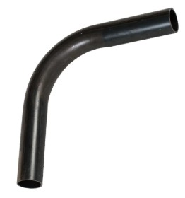

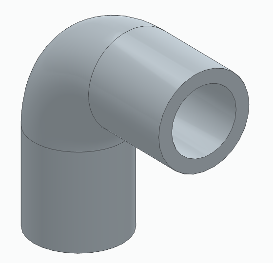

### 2.1. Tabela de dimensões e parâmetros

| Elemento | Parâmetro | Valor |
|---|---|---|
| Trajetória | Plano do esboço | **Front (xz)** |
| Trajetória | Ângulo da curva | **90°** |
| Trajetória | Raio da linha de centro | **R 27,5 mm**, com centro na origem |
| Trajetória | Trecho reto vertical | **35 mm**, medido a partir do ponto de tangência |
| Trajetória | Trecho reto horizontal | **35 mm**, medido a partir do ponto de tangência |
| Trajetória | Comprimento total | 35 + 35 + (π/2) × 27,5 = **113,20 mm** |
| Perfil externo | Diâmetro | **Ø 35 mm** |
| Perfil interno | Diâmetro | **Ø 25 mm** |
| Parede | Espessura | **5 mm** = (35 − 25) / 2 |
| Recursos | Tipo | **Swept Protrusion** e **Swept Cutout** |
| Unidades | Sistema | Milímetros (mm) |

> **Condição geométrica:** o raio da linha de centro (27,5 mm) precisa ser **maior que o raio externo do tubo** (17,5 mm). Caso contrário, a parte interna da curva se cruza consigo mesma e a varredura falha. Aqui sobram 27,5 − 17,5 = 10 mm no lado interno da curva.

## 3. Procedimento experimental

### Etapa 1 — Criar o documento da peça

1. Abra o **Solid Edge** e crie um documento **Part** (modelo ISO métrico).
2. Confira **Ordered** no topo do **PathFinder**. Se estiver em *Synchronous*, troque para *Ordered*.
3. Salve com nome identificável, por exemplo `Aula6_Tubo_Curvado.par`.
4. No PathFinder, expanda **Base Reference Planes** e identifique os planos **Top (xy)**, **Right (yz)** e **Front (xz)**.

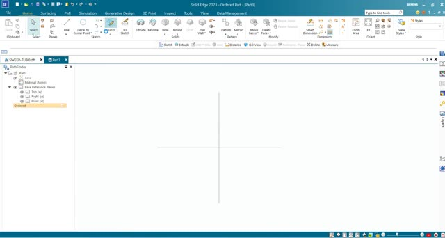

### Etapa 2 — Desenhar a trajetória

1. Na guia **Home**, clique em **Sketch** e selecione o plano **Front (xz)**.

   

2. Clique em **Line**. No painel **Line and Arc**, alterne entre **Line**  e **Arc**  sem sair do comando; as teclas **L** e **A** fazem a mesma troca.

   

   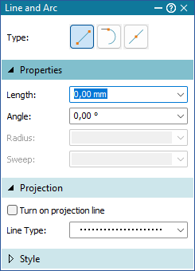

3. Desenhe em sequência, sem soltar o comando:
   - o **trecho vertical**, de baixo para cima;
   - troque para **Arc** e desenhe o **arco de 90°** saindo tangente do trecho vertical;
   - troque para **Line** e desenhe o **trecho horizontal**, saindo tangente do arco.
4. Confira as relações: **Connect**  nas extremidades e **Tangent**  entre o arco e cada reta. Desenhando em sequência, o IntelliSketch costuma criá-las sozinho; as que faltarem devem ser aplicadas pelo grupo **Relate**. Use **Horizontal/Vertical**  nos trechos retos, se necessário.
5. Coloque o **centro do arco na origem** (relação Connect entre o centro e a origem) e cote com **Smart Dimension**: **R 27,5**, **35** no trecho vertical e **35** no trecho horizontal, ambos a partir dos pontos de tangência.

   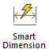

6. Clique em **Close Sketch**. O esboço aparece como **Sketch 1**.

   

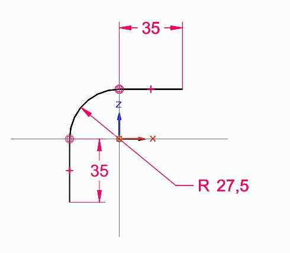

**Verificação:** a trajetória deve ser **contínua e aberta**, sem lacunas nem sobreposições. Uma trajetória desconectada impede a varredura.

### Etapa 3 — Criar um plano normal à trajetória

1. Na guia **Home**, grupo **Planes**, clique em **More Planes**  e escolha **Normal to Curve** .

   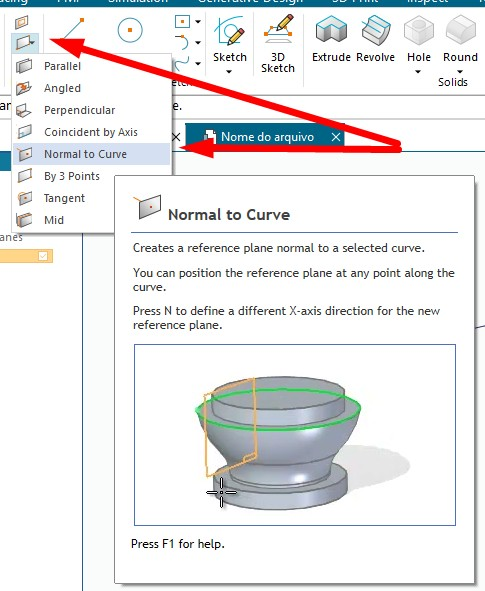

2. A barra de mensagens pede *"Click on a curve or edge for the normal plane"*. Clique no **trecho vertical** da trajetória, perto da **extremidade inferior**.
3. Posicione o plano na **extremidade inferior** (o ponto final do trecho) e clique para confirmar. O plano fica perpendicular à trajetória nesse ponto e aparece como **Plane 4**.

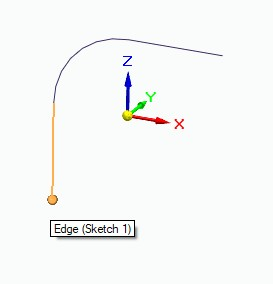

**Conceito:** o perfil de uma varredura deve ser desenhado em um plano **perpendicular à trajetória** no ponto em que ela começa. Assim a seção transversal do tubo fica circular e com o diâmetro especificado ao longo de todo o percurso.

### Etapa 4 — Desenhar o perfil externo

1. Clique em **Sketch**  e selecione o **Plane 4**.
2. Com **Circle by Center Point**, desenhe um círculo com centro **no ponto onde a trajetória atravessa o plano** (use o ponto final da trajetória como referência).

   

3. Cote o diâmetro com **Smart Dimension**: **Ø 35 mm**. Clique em **Close Sketch**. O esboço aparece como **Sketch 2**.

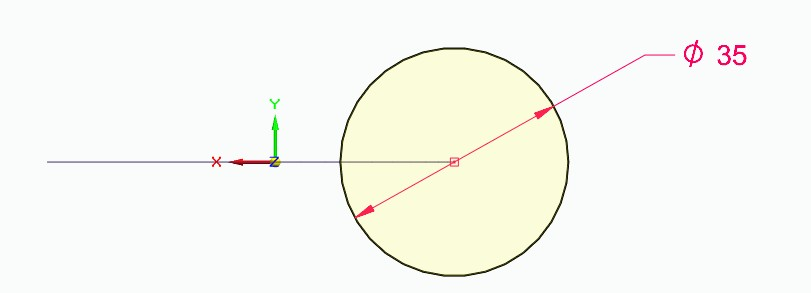

### Etapa 5 — Swept Protrusion (varredura com adição de material)

1. Na guia **Home**, grupo **Solids**, abra o menu **Add**  (botão pequeno à direita de **Thin Wall**, com o ícone laranja) e escolha **Sweep** .

   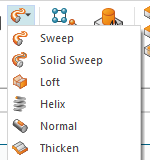

2. Abre o diálogo **Sweep Options**. Mantenha **Single path and cross section** e os demais valores padrão (*No merge*, *Normal*, *Tangent continuous*, *Thin Wall* desmarcado) e clique em **OK**.

   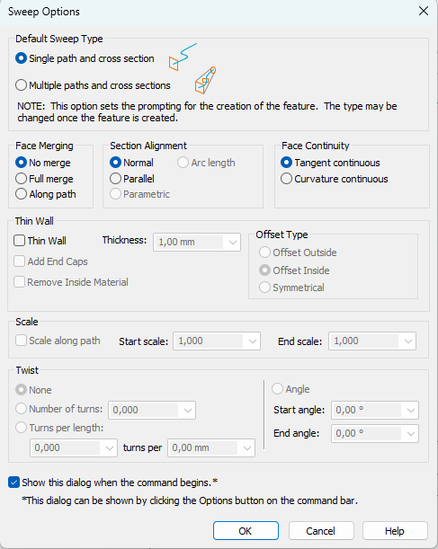

3. Na etapa **Path**, clique na trajetória (**Sketch 1**) e aceite (✓).
4. Na etapa **Cross Section**, clique no círculo **Ø 35** (**Sketch 2**) e aceite (✓).
5. Confira a prévia e clique em **Finish**. O recurso aparece como **Protrusion 1**.

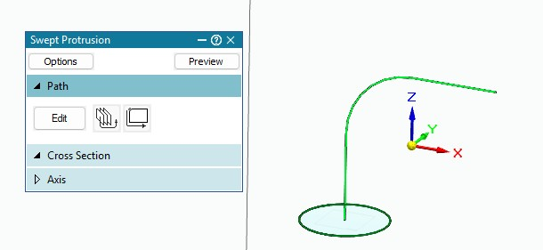

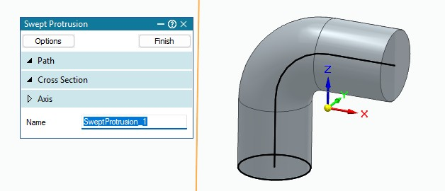

**Conferência:** o volume do sólido maciço é a área da seção vezes o comprimento da trajetória (teorema de Pappus): π × 17,5² × 113,20 ≈ **108 908 mm³**.

### Etapa 6 — Swept Cutout (furo interno por varredura)

1. Clique em **Sketch**  e selecione novamente o **Plane 4** (ou a face circular da extremidade inferior do tubo).
2. Com **Circle by Center Point** , desenhe um círculo **concêntrico** ao perfil externo e cote **Ø 25 mm**. Clique em **Close Sketch**. O esboço aparece como **Sketch 3**.

   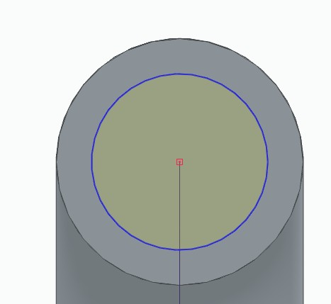

3. No grupo **Solids**, abra o menu **Cut**  (botão pequeno com o ícone cinza, logo abaixo do menu Add) e escolha **Sweep** .

   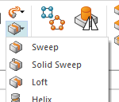

4. Em **Sweep Options**, mantenha **Single path and cross section** e clique em **OK**.
5. Em **Path**, selecione a mesma trajetória (**Sketch 1**) e aceite. Em **Cross Section**, selecione o círculo **Ø 25** (**Sketch 3**) e aceite.
6. Clique em **Finish**. O recurso aparece como **Cutout 1**.

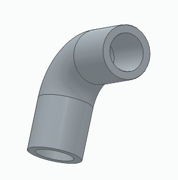

**Atenção:** os menus **Add** e **Cut** têm um item **Sweep** cada um. O do Add **adiciona** material (Swept Protrusion); o do Cut **remove** (Swept Cutout). Para o furo interno, use o do **Cut**.

> **Alternativa (não exigida):** o diálogo **Sweep Options** tem a opção **Thin Wall**, que gera o tubo oco já na Etapa 5. Nesta atividade usamos o corte por varredura para praticar o **Swept Cutout**.

### Etapa 7 — Conferir o modelo e salvar

1. Confira a árvore no **PathFinder**:

   ```text
   Sketch 1       Trajetória: 35 + arco R 27,5 + 35
   Plane 4        Normal to Curve, na extremidade inferior
   Sketch 2       Círculo Ø 35
   Protrusion 1   Swept Protrusion
   Sketch 3       Círculo Ø 25
   Cutout 1       Swept Cutout
   ```

   Nenhum item deve aparecer com ícone de erro ou aviso. Passe o mouse sobre um recurso suspeito para ler a mensagem.

2. Na guia **Inspect**, grupo **Physical Properties**, clique em **Properties** e depois em **Update** (o diálogo abre desatualizado, com valores zerados).

   

3. Compare com os valores de referência:

   | Após o recurso | Volume (mm³) | Cálculo |
   |---|---:|---|
   | Protrusion 1 (maciço) | 108 908,2 | π × 17,5² × 113,20 |
   | Cutout 1 (peça final) | **53 342,8** | π × (17,5² − 12,5²) × 113,20 |

   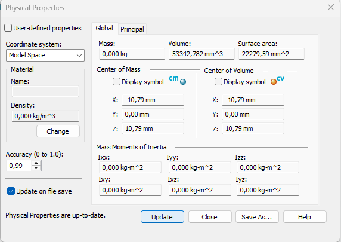

   O **centro de volume** tem **X = −Z** (≈ −10,79 e 10,79 mm), porque o cotovelo é simétrico em relação à diagonal entre os dois trechos retos.

4. Salve o arquivo.

## 4. Resultado esperado

Um tubo curvado a 90°, com dois trechos retos de 35 mm e linha de centro em arco de R 27,5 mm, diâmetro externo de 35 mm, diâmetro interno de 25 mm e parede de 5 mm, construído por **Swept Protrusion** e **Swept Cutout** a partir da mesma trajetória.


## 5. Erros frequentes

| Erro | Correção |
|---|---|
| Trajetória com extremidades soltas | Desenhar linha, arco e linha em sequência no comando **Line**, ou aplicar **Connect** nas extremidades |
| Arco sem tangência com as retas | Aplicar **Tangent** entre o arco e cada trecho reto |
| Cotar 35 mm a partir do centro do arco | Os 35 mm partem dos **pontos de tangência** |
| Perfil desenhado em plano não perpendicular à trajetória | Criar o plano com **Normal to Curve** na extremidade da trajetória |
| Círculo fora da trajetória | Centrar o círculo no ponto onde a trajetória atravessa o plano |
| Raio da curva menor que o raio do tubo | Manter R 27,5 > 17,5; caso contrário a varredura falha |
| Usar **Add › Sweep** para o furo interno | Usar **Cut › Sweep** (Swept Cutout) |
| Círculo interno não concêntrico | Usar o mesmo centro do perfil externo; a parede deve ter 5 mm em toda a volta |
| Ler o volume sem atualizar | Clicar em **Update** no Physical Properties |
