# Atividade 07 — Modelagem de tubo curvado no Solid Edge

**Disciplina:** Desenho Assistido por Computador (DAC)  
**Ambiente:** Solid Edge — **Part**, modelagem **Ordered**  
**Atividade:** Construção de componente tubular com curva de 90° por varredura de perfil circular.

## 1. Objetivo

Modelar uma peça tubular curvada a partir de uma trajetória plana e de uma seção circular, empregando ferramentas de esboço, cotagem e **Swept Protrusion** (protrusão por varredura). Ao final, o estudante deverá conseguir distinguir **trajetória**, **perfil transversal**, **raio de curvatura** e **diâmetro externo**, além de conferir o sólido resultante.

## 2. Proposta de modelagem

Construir um tubo ou barra circular curvada, com dois segmentos retos unidos por um arco tangente de aproximadamente 90°. A operação principal consiste em conduzir um perfil circular ao longo de uma trajetória composta.

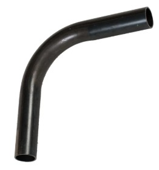

### 2.1. Tabela de dimensões e parâmetros

| Elemento | Parâmetro | Valor / critério |
|---|---|---|
| Trajetória | Ângulo da curva | **90°** |
| Trajetória | Raio da linha de centro | **R 27,5 mm** — confirmar referência geométrica |
| Trecho horizontal | Comprimento reto | **35 mm** — distância horizontal indicada no desenho |
| Perfil | Diâmetro externo | **Ø 4 mm** |
| Perfil | Diâmetro interno | **Ø 2,5 mm** |
| Perfil | Espessura da parede | **0,75 mm** — calculada a partir dos diâmetros |
| Operação | Tipo de recurso | **Swept Protrusion** (varredura de seção) |
| Unidades | Sistema | **Milímetros (mm)** |

## 3. Procedimento experimental

### Etapa 1 — Criar o documento da peça

1. Abra o **Solid Edge** e crie um documento no ambiente **Part**.
2. Selecione o modo de modelagem **Ordered** quando aplicável.
3. Confira as unidades do arquivo e salve o documento com nome identificável, por exemplo `Aula19_Tubo_Curvado.par`.
4. Localize o **PathFinder** e identifique os planos de referência disponíveis.

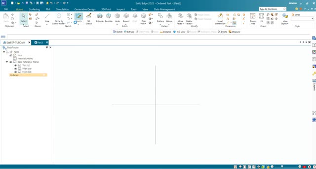

**Registro de ícone:** inserir recorte do botão de criação de esboço e da seleção de plano, conforme a versão instalada.

### Etapa 2 — Construir a trajetória do tubo

1. Na faixa de opções, acesse **Home → Sketch** e selecione um plano de referência adequado.
2. No ambiente de esboço, construa um segmento reto vertical e um segmento reto horizontal, conectados por um **Arc** de aproximadamente 90°.
3. Utilize os comandos de desenho de linhas e arcos da guia de esboço (**Line** e **Arc**, na região de ferramentas de desenho).
4. Aplique relações geométricas de **coincidência** entre as extremidades e de **tangência** entre o arco e cada trecho reto. A trajetória deve ser contínua, sem interrupções.
5. Use **Smart Dimension** para fixar o raio e os comprimentos de acordo com o desenho técnico.
6. Finalize o esboço com **Finish Sketch**.

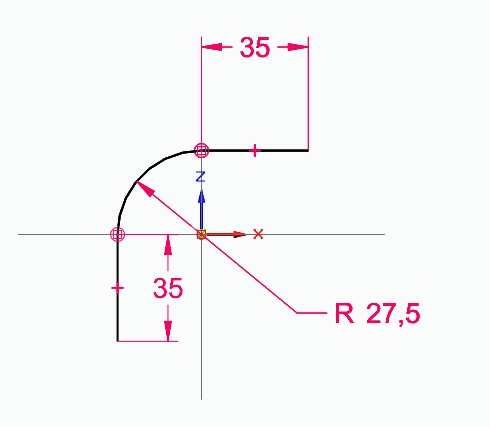

### Etapa 3 — Adicionando novo plano

1. Clique em More Plans

2. Selecione a opção Normal to Curve

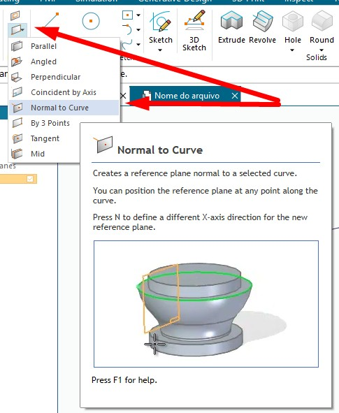

3. Selecione o início da curva

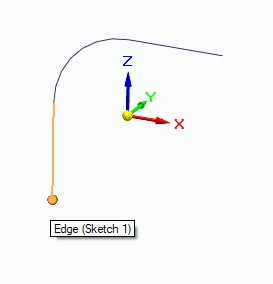

4. Clique em **Sketch**, selecione o plano criado, adicione um círculo

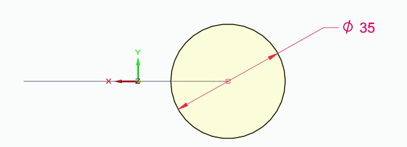

### Etapa 3 — Preparar o plano e o perfil transversal

1. Inicie a operação de varredura pela guia **Home**, no grupo de recursos sólidos, escolhendo **Swept Protrusion** (a posição exata do comando pode variar entre versões do Ribbon).
2. Indique a trajetória construída na etapa anterior, seguindo a sequência solicitada pela barra de comandos da versão utilizada.

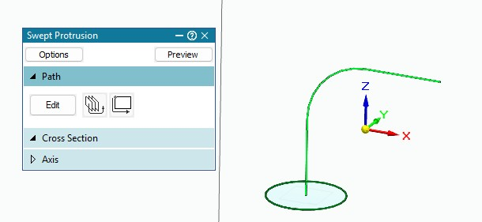

3. Defina um plano transversal à extremidade da trajetória para desenhar a seção.

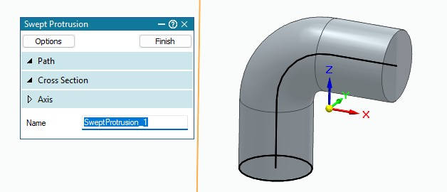

### Etapa 4 — Corte Interno

1. Na faixa de opções, acesse **Home → Sketch** e selecione o plano do início ou final do tubo

2. Insira um círculo 

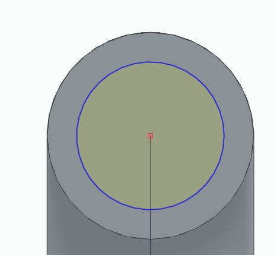

3. Finalize o Sketch

4. Selecione Cut -> Sweep

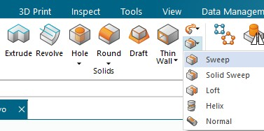

5. OK -> Selecione o Caminho -> Selecione a face (círculo) -> finish

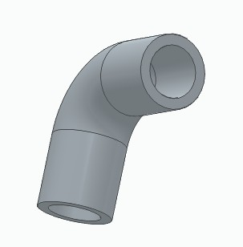

