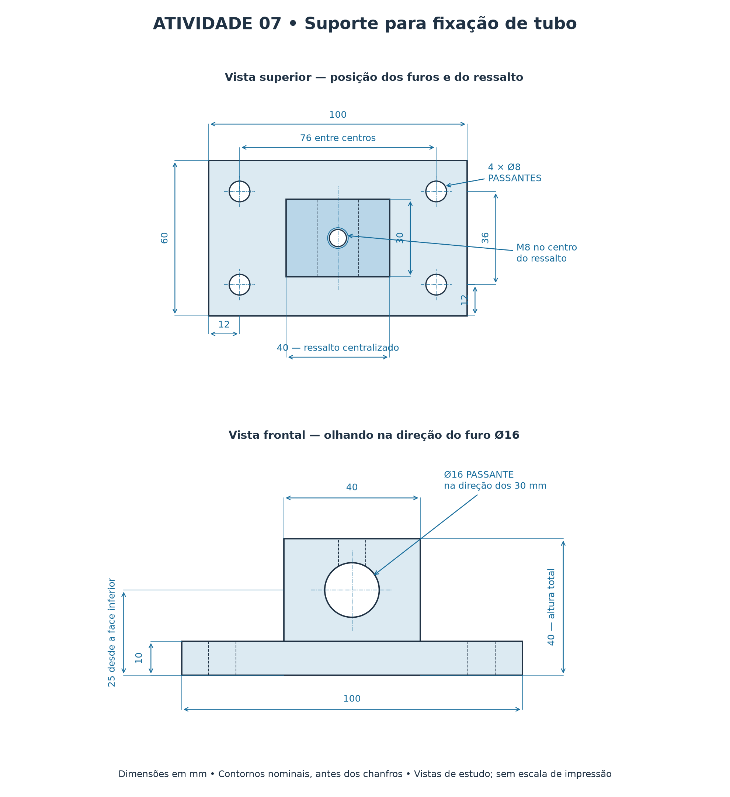
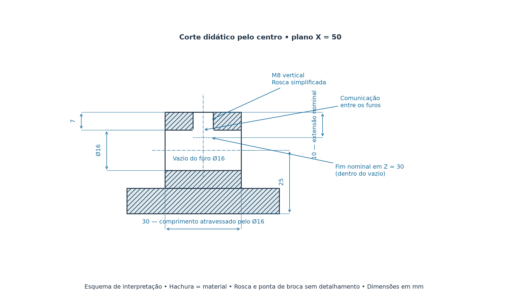
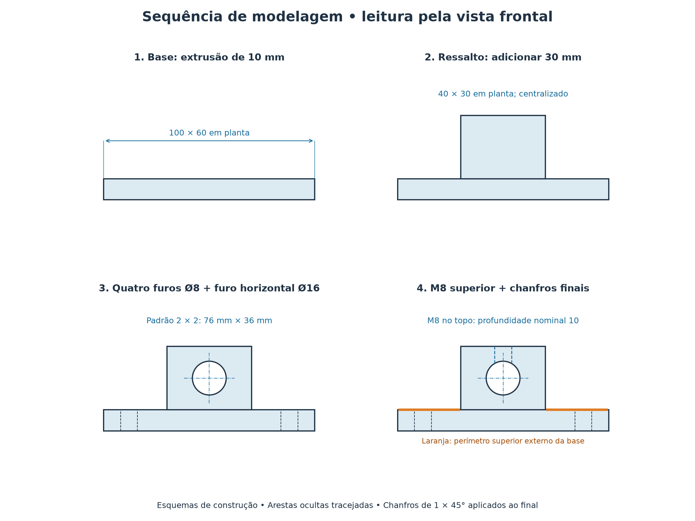

# Atividade 07 — Resolução comentada do suporte para fixação de tubo

**Referência:** [enunciado do exercício](exercicio_suporte_para_fixacao_de_tubo.md)  
**Software:** Solid Edge — Part / Ordered e Draft  
**Unidades:** milímetros (mm)

Este documento apresenta uma solução de modelagem e os valores para conferência. Outras sequências de operações são válidas quando atendem aos requisitos. Os nomes e a localização dos comandos podem variar com a versão e o idioma do Solid Edge.



**Figura 1 — Geometria nominal e posicionamento dos furos.** Vistas de estudo sem escala de impressão, antes dos chanfros. Sua disposição não define um sistema de projeção.

## 1. Interpretação geométrica

Adote a origem em um canto inferior da base, antes dos chanfros, com:

- **X:** direção do comprimento de 100 mm;
- **Y:** direção da largura de 60 mm;
- **Z:** direção da altura, positiva para cima.

### 1.1. Base e ressalto

| Elemento | Intervalo em X | Intervalo em Y | Intervalo em Z |
|---|---|---|---|
| Base | 0 a 100 | 0 a 60 | 0 a 10 |
| Ressalto | 30 a 70 | 15 a 45 | 10 a 40 |

Os afastamentos do ressalto em relação às bordas da base são:

```text
Na direção X: (100 − 40) / 2 = 30 mm de cada lado
Na direção Y: (60 − 30) / 2 = 15 mm de cada lado
Altura total: 10 + 30 = 40 mm
```

### 1.2. Furos de fixação

Os eixos são verticais, paralelos a Z. Suas posições em planta são:

| Furo | X | Y | Diâmetro | Extensão |
|---|---:|---:|---|---|
| 1 | 12 | 12 | Ø8 | Passante na base |
| 2 | 88 | 12 | Ø8 | Passante na base |
| 3 | 12 | 48 | Ø8 | Passante na base |
| 4 | 88 | 48 | Ø8 | Passante na base |

O padrão possui **duas posições em X e duas em Y**, incluindo o furo inicial. As distâncias entre centros são:

```text
Passo em X = 100 − 2 × 12 = 76 mm
Passo em Y = 60 − 2 × 12 = 36 mm
Quantidade total = 2 × 2 = 4 furos
```

### 1.3. Furo para o tubo e furo roscado

| Recurso | Posição / orientação |
|---|---|
| Furo de Ø16 mm | Eixo paralelo a Y, em X = 50 e Z = 25; atravessa o ressalto de Y = 15 a Y = 45 |
| Furo M8 | Eixo paralelo a Z, em X = 50 e Y = 30; inicia em Z = 40 e avança 10 mm para baixo |

Na face frontal do ressalto, o centro do furo de Ø16 mm está a **20 mm de uma borda lateral** e a **15 mm da base do próprio ressalto**. Essa última cota equivale a 25 mm da face inferior da base:

```text
25 − 10 = 15 mm
```

O raio do furo horizontal é 8 mm. No plano central X = 50, seu ponto superior está em Z = 33 mm:

```text
Topo do furo horizontal = 25 + 8 = 33 mm
Material entre o topo do ressalto e esse ponto = 40 − 33 = 7 mm
Fim nominal do recurso roscado = 40 − 10 = 30 mm
```

Assim, o recurso vertical de 10 mm alcança o vazio do furo horizontal. A espessura de material atravessada varia na superfície de interseção: **7 mm é a espessura no eixo central, não o comprimento uniforme de rosca útil**. O exercício é de modelagem; não solicita cálculo de resistência do travamento.



**Figura 2 — Interseção dos furos no plano X = 50.** A representação da rosca é simplificada e a ponta da broca não está detalhada. A linha tracejada em Z = 30 marca o fim nominal do recurso dentro do vazio.

## 2. Modelagem resolvida



**Figura 3 — Sequência de construção.** Os esquemas mostram a evolução pela vista frontal; as dimensões de profundidade estão indicadas em texto. A marcação laranja identifica o perímetro superior externo da base escolhido para os chanfros, sem representar seu tamanho em escala.

### Etapa 1 — Criar a base

1. Crie um documento **Part**, em **Ordered**, com unidades em milímetros.
2. Salve como `Nome_Suporte_Tubo.par`.
3. No plano XY, crie um esboço retangular de **100 × 60 mm**.
4. Posicione um canto na origem e dimensione o esboço.
5. Finalize o esboço e aplique **Extrude** com **10 mm** no sentido positivo de Z.

**Conferência:** a base ocupa de Z = 0 a Z = 10.

### Etapa 2 — Criar o ressalto

1. Inicie um esboço na face superior da base.
2. Desenhe um retângulo de **40 × 30 mm**, com o lado de 40 mm paralelo a X.
3. Posicione seu canto em **X = 30 mm e Y = 15 mm**, ou use relações de centralização equivalentes.
4. Aplique uma extrusão de **30 mm acima da base**, com adição de material ao sólido existente.

**Conferência:** a face superior fica em Z = 40. O ressalto não deve formar um corpo separado.

### Etapa 3 — Criar o primeiro furo de fixação

1. Acione **Hole** e selecione a face superior exposta da base.
2. Configure um furo simples de **Ø8 mm**, com extensão passante.
3. Posicione seu centro a **12 mm da borda X = 0** e a **12 mm da borda Y = 0**.
4. Oriente a remoção de material para dentro da base e conclua o comando.

**Conferência:** o eixo do primeiro furo está em X = 12 e Y = 12.

### Etapa 4 — Distribuir os furos por padrão

1. Acione **Rectangular Pattern** e selecione o recurso do furo de Ø8 mm.
2. Utilize um plano paralelo à base para definir as direções.
3. Configure **duas ocorrências em X**, com distância entre centros de **76 mm**.
4. Configure **duas ocorrências em Y**, com distância entre centros de **36 mm**.
5. Confira os sentidos das direções e confirme a operação.

**Conferência:** a prévia deve mostrar quatro furos nas coordenadas da seção 1.2. Verifique se o campo do software representa espaçamento ou extensão total; com duas posições por direção, os valores entre a primeira e a última são 76 e 36 mm.

### Etapa 5 — Criar o furo horizontal de Ø16 mm

1. Acione **Hole** e selecione uma face vertical do ressalto com dimensões de **40 × 30 mm**, por exemplo a face situada em Y = 15.
2. Configure um furo simples de **Ø16 mm**, passante.
3. Posicione o centro a **20 mm de uma borda lateral do ressalto** e a **15 mm de sua borda inferior**, situada sobre a base.
4. Oriente o furo para atravessar o ressalto ao longo de Y e conclua a operação.

**Conferência:** o furo atravessa 30 mm de material na direção Y. Seu eixo está em X = 50 e Z = 25, centralizado na face escolhida.

### Etapa 6 — Criar o furo roscado M8

1. Acione **Hole** e selecione a face superior do ressalto.
2. Escolha a opção de furo roscado, o padrão **ISO Metric**, o tamanho **M8** e seu passo normal na tabela do software.
3. Posicione o centro a **20 mm de uma borda na direção X** e a **15 mm de uma borda na direção Y**. Isso corresponde a X = 50 e Y = 30 na peça.
4. Configure a extensão nominal do furo em **10 mm**, a partir da face superior e para baixo. Se houver campos separados de profundidade do furo e da rosca, use **10 mm para ambos** nesta atividade.
5. Confira a prévia e conclua a operação.

**Conferência:** o furo começa em Z = 40 e seu fim nominal está em Z = 30. A abertura deve comunicar-se com o furo de Ø16 mm. Gire o modelo e inspecione essa comunicação pelo furo horizontal; use uma seção de inspeção, se disponível e necessária.

O fundo de broca pode incluir uma ponta cônica conforme a configuração do recurso. O valor de 10 mm deve ser informado no campo de profundidade do furo, sem estimá-lo visualmente pela ponta.

Não substitua o recurso roscado por um furo simples de Ø8 mm. Utilize a definição M8 da tabela e preserve as informações de rosca para o desenho. A aparência gráfica pode representar a rosca de forma simplificada, sem espiras modeladas por Helix.

### Etapa 7 — Aplicar os chanfros

Uma escolha de referência para esta resolução é chanfrar **as quatro arestas do perímetro superior externo da base**, em Z = 10, com **1 × 45°**.

1. Acione **Chamfer**.
2. Selecione somente essas quatro arestas externas da base.
3. Configure **1 mm e 45°**, ou distâncias iguais de 1 mm nas faces perpendiculares, conforme a opção disponível.
4. Confira a prévia e confirme.

Essa seleção mantém as bocas dos furos e as arestas do ressalto sem chanfro. Outras escolhas são aceitas pelo enunciado, desde que registradas no desenho e sem prejuízo aos detalhes funcionais.

### Etapa 8 — Revisar o modelo

Uma árvore de recursos possível é:

```text
Extrusão — Base 100 × 60 × 10
Extrusão — Ressalto 40 × 30 × 30
Furo — Ø8 passante
Padrão retangular — 2 × 2; espaçamentos 76 e 36
Furo — Ø16 passante, horizontal
Furo roscado — M8; profundidade nominal 10
Chanfro — 1 × 45° no perímetro superior externo da base
```

Confira se os recursos não apresentam falhas e salve o arquivo.

## 3. Desenho técnico resolvido

1. Crie um documento **Draft** e selecione o arquivo `.par` pelo assistente de vistas.
2. Adote como frontal a orientação olhando ao longo de Y, para visualizar o furo de Ø16 mm como círculo.
3. Insira as vistas superior e lateral necessárias e uma vista isométrica.
4. Organize as vistas segundo o sistema de projeção adotado na disciplina.
5. Ajuste a escala para preservar espaço para as cotas.
6. Insira linhas de centro e marcas de centro onde forem necessárias.

### 3.1. Distribuição sugerida das informações

| Vista | Informações principais |
|---|---|
| Superior | Base 100 × 60; ressalto 40 × 30; afastamentos de 30 e 15 do ressalto; posição dos quatro furos; chamada do furo M8 centralizado |
| Frontal | Espessura da base de 10; altura total de 40; furo Ø16 passante; eixo a 25 da face inferior da base e centralizado no ressalto |
| Lateral | Informações complementares para compreender o furo horizontal e a comunicação com o furo vertical, sem repetir cotas já suficientes |
| Isométrica | Forma geral da peça e indicação dos chanfros, quando a chamada ficar mais clara nessa vista |

Para localizar os quatro furos na vista superior, pode-se cotar **12 mm até o primeiro centro e 76 mm entre centros em X**, e **12 mm até o primeiro centro e 36 mm entre centros em Y**. Com o contorno de 100 × 60, isso define também as margens opostas de 12 mm; evite acrescentar cotas redundantes.

Indique o furo M8 no centro do ressalto por linhas de centro e informações de centralização inequívocas, ou por cotas de posição suficientes. No furo horizontal, a centralização na dimensão de 40 mm pode ser definida por uma cota de 20 mm até seu eixo.

### 3.2. Chamadas sugeridas

- **`4 × Ø8 PASSANTE`**, com linha de chamada para um dos furos de fixação.
- **`Ø16 PASSANTE`**, na vista em que esse furo aparece como círculo.
- **`M8 — PROFUNDIDADE NOMINAL 10 mm`**, preferencialmente com anotação de furo vinculada ao recurso. Mantenha a identificação do passo conforme o padrão adotado no desenho.
- **`FURO M8 COMUNICANTE COM Ø16`**, se necessário para esclarecer a interseção.
- **`1 × 45° — NAS 4 ARESTAS DO PERÍMETRO SUPERIOR EXTERNO DA BASE`**, com chamada para uma aresta correspondente, nesta solução.

Se as linhas ocultas tornarem a leitura confusa, uma vista em corte pelo plano X = 50 evidencia os dois furos comunicantes. Esse corte é uma opção complementar; não é necessário exigir um comando ainda não estudado.

### 3.3. Finalização

1. Preencha identificação, título, unidades e escala.
2. Atualize todas as vistas após salvar a versão final do modelo.
3. Salve como `Nome_Suporte_Tubo.dft`.
4. Exporte como `Nome_Suporte_Tubo.pdf`.
5. Abra o PDF e confira legibilidade, símbolos, enquadramento e ausência de cortes na folha.

## 4. Gabarito de conferência

| Verificação | Resultado esperado |
|---|---|
| Dimensões gerais antes dos chanfros | 100 × 60 × 40 mm |
| Ressalto | Centralizado; altura de 30 mm acima da base |
| Margens do ressalto | 30 mm em X e 15 mm em Y, de cada lado |
| Furos de fixação | Quatro de Ø8, passantes, nas coordenadas indicadas |
| Distâncias entre centros de fixação | 76 mm em X e 36 mm em Y |
| Eixo do furo horizontal | Paralelo a Y; X = 50 e Z = 25 |
| Material abaixo e acima do furo horizontal no ressalto | 7 mm em cada lado, medidos no plano central vertical |
| Eixo do furo roscado | Vertical; X = 50 e Y = 30 |
| Profundidade nominal do recurso M8 | 10 mm, comunicando-se com Ø16 |
| Chanfros desta resolução | Quatro arestas do perímetro superior externo da base; 1 × 45° |
| Arquivos finais | `.par`, `.dft` e PDF coerentes entre si |

## 5. Erros frequentes

| Erro | Correção |
|---|---|
| Usar 30 mm como altura total da peça | Extrudar o ressalto 30 mm sobre a base de 10 mm; total de 40 mm |
| Medir os 25 mm a partir do topo da base | A referência é a face inferior; na face do ressalto, a cota local é 15 mm |
| Orientar o furo Ø16 ao longo dos 40 mm | Selecionar a face de 40 × 30 mm para que o eixo atravesse a profundidade de 30 mm |
| Distribuir os furos a 12 mm entre si | Os 12 mm são margens; os espaçamentos são 76 e 36 mm |
| Configurar três ocorrências por direção | Utilizar duas posições por direção, totalizando quatro furos |
| Criar um furo simples Ø8 no lugar de M8 | Configurar um furo roscado pela tabela ISO Metric |
| Fazer o furo M8 atravessar a peça inteira | Usar extensão nominal de 10 mm a partir do topo do ressalto |
| Considerar 10 mm como comprimento contínuo de rosca em material | Observar a interseção com o furo horizontal e a espessura central de 7 mm |
| Anotar chanfro em todas as arestas sem tê-las chanfrado | Identificar somente as arestas efetivamente selecionadas |
| Exportar um desenho desatualizado | Salvar o modelo, atualizar as vistas e exportar novamente |
