# Atividade 07 — Resolução comentada do suporte para fixação de tubo

**Referência:** [enunciado do exercício](exercicio_suporte_para_fixacao_de_tubo.md)  
**Software:** Solid Edge — Part / Ordered e Draft (procedimento validado no Solid Edge 2026, interface em inglês)  
**Unidades:** milímetros (mm)  
**Modelo de referência:** [`modelo/Gabarito_Suporte_Tubo.par`](modelo/Gabarito_Suporte_Tubo.par)

Este documento apresenta uma solução de modelagem e os valores para conferência. Outras sequências de operações são válidas quando atendem aos requisitos. Os nomes e a localização dos comandos podem variar com a versão e o idioma do Solid Edge. Os ícones e as telas reproduzidos aqui são do Solid Edge 2026.

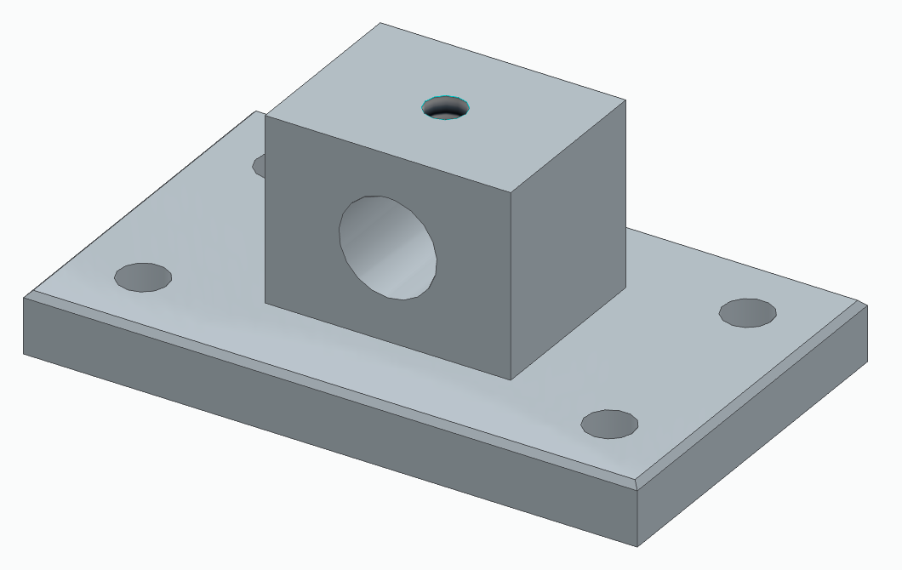

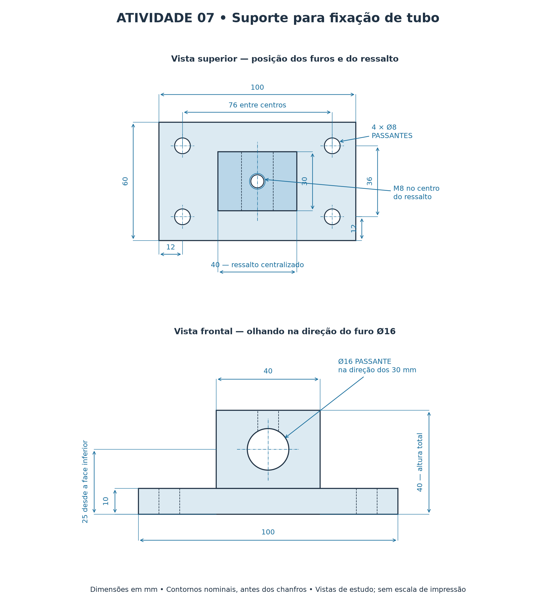

**Figura 1 — Geometria nominal e posicionamento dos furos.** Vistas de estudo sem escala de impressão, antes dos chanfros. Sua disposição não define um sistema de projeção.

## 1. Interpretação geométrica

Adote a origem em um canto inferior da base, antes dos chanfros, com:

- **X:** direção do comprimento de 100 mm;
- **Y:** direção da largura de 60 mm;
- **Z:** direção da altura, positiva para cima.

### 1.1. Base e ressalto

| Elemento | Intervalo em X | Intervalo em Y | Intervalo em Z |
|---|---|---|---|
| Base | 0 a 100 | 0 a 60 | 0 a 10 |
| Ressalto | 30 a 70 | 15 a 45 | 10 a 40 |

Os afastamentos do ressalto em relação às bordas da base são:

```text
Na direção X: (100 − 40) / 2 = 30 mm de cada lado
Na direção Y: (60 − 30) / 2 = 15 mm de cada lado
Altura total: 10 + 30 = 40 mm
```

### 1.2. Furos de fixação

Os eixos são verticais, paralelos a Z. Suas posições em planta são:

| Furo | X | Y | Diâmetro | Extensão |
|---|---:|---:|---|---|
| 1 | 12 | 12 | Ø8 | Passante na base |
| 2 | 88 | 12 | Ø8 | Passante na base |
| 3 | 12 | 48 | Ø8 | Passante na base |
| 4 | 88 | 48 | Ø8 | Passante na base |

O padrão possui **duas posições em X e duas em Y**, incluindo o furo inicial. As distâncias entre centros são:

```text
Passo em X = 100 − 2 × 12 = 76 mm
Passo em Y = 60 − 2 × 12 = 36 mm
Quantidade total = 2 × 2 = 4 furos
```

### 1.3. Furo para o tubo e furo roscado

| Recurso | Posição / orientação |
|---|---|
| Furo de Ø16 mm | Eixo paralelo a Y, em X = 50 e Z = 25; atravessa o ressalto de Y = 15 a Y = 45 |
| Furo M8 | Eixo paralelo a Z, em X = 50 e Y = 30; inicia em Z = 40 e avança 10 mm para baixo |

Na face frontal do ressalto, o centro do furo de Ø16 mm está a **20 mm de uma borda lateral** e a **15 mm da base do próprio ressalto**. Essa última cota equivale a 25 mm da face inferior da base:

```text
25 − 10 = 15 mm
```

O raio do furo horizontal é 8 mm. No plano central X = 50, seu ponto superior está em Z = 33 mm:

```text
Topo do furo horizontal = 25 + 8 = 33 mm
Material entre o topo do ressalto e esse ponto = 40 − 33 = 7 mm
Fim nominal do recurso roscado = 40 − 10 = 30 mm
```

Assim, o recurso vertical de 10 mm alcança o vazio do furo horizontal. A espessura de material atravessada varia na superfície de interseção: **7 mm é a espessura no eixo central, não o comprimento uniforme de rosca útil**. O exercício é de modelagem; não solicita cálculo de resistência do travamento.

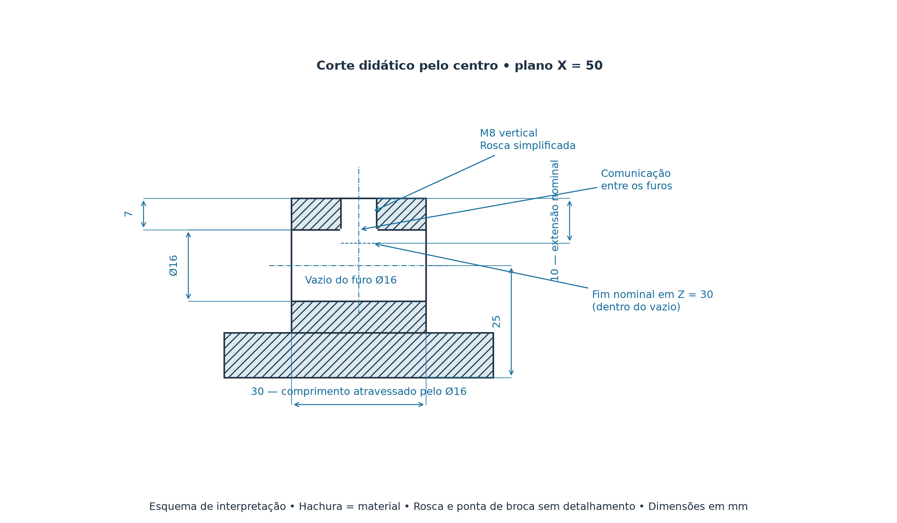

**Figura 2 — Interseção dos furos no plano X = 50.** A representação da rosca é simplificada e a ponta da broca não está detalhada. A linha tracejada em Z = 30 marca o fim nominal do recurso dentro do vazio.

## 2. Modelagem resolvida

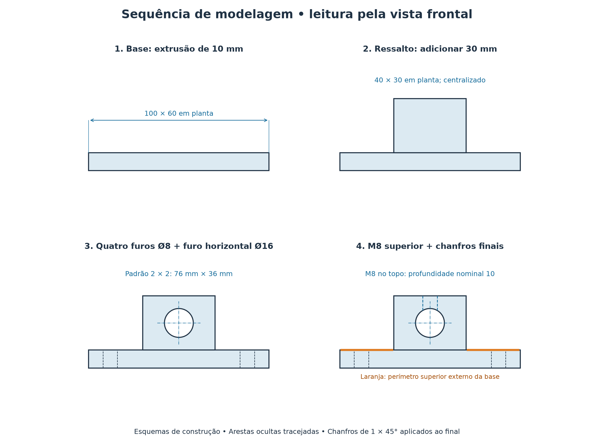

**Figura 3 — Sequência de construção.** Os esquemas mostram a evolução pela vista frontal; as dimensões de profundidade estão indicadas em texto. A marcação laranja identifica o perímetro superior externo da base escolhido para os chanfros, sem representar seu tamanho em escala.

### Etapa 1 — Criar a base

1. Crie um documento **Part** (modelo ISO métrico), confira **Ordered** no topo do PathFinder e salve como `Nome_Suporte_Tubo.par`.
2. Na guia **Home**, clique em **Sketch** e selecione o plano **Top (xy)**.

   

3. No grupo **Draw**, abra o menu do retângulo  e escolha **Rectangle by 2 Points** . Desenhe o retângulo com um canto na origem.
4. Cote com **Smart Dimension**: **100 mm** em X e **60 mm** em Y. Clique em **Close Sketch**.

   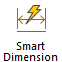 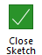

5. Clique em **Extrude**, selecione o esboço, digite **10 mm**, escolha o sentido **+Z** (para cima) e clique em **Finish**.

   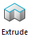

**Conferência:** a base ocupa de Z = 0 a Z = 10. No PathFinder aparecem **Sketch 1** e **Protrusion 1**.

### Etapa 2 — Criar o ressalto

1. Clique em **Sketch**  e selecione a **face superior da base**.
2. Desenhe um retângulo de **40 × 30 mm** com **Rectangle by 2 Points**, com o lado de 40 mm paralelo a X.
3. Posicione-o com cotas de **30 mm** até a borda X = 0 e **15 mm** até a borda Y = 0, ou use relações de centralização equivalentes. Clique em **Close Sketch** .
4. Clique em **Extrude** , selecione o esboço e extrude **30 mm** para cima, adicionando material ao sólido existente.

**Conferência:** a face superior fica em Z = 40. O ressalto não deve formar um corpo separado: em **Design Bodies** continua existindo apenas **Design Body_1**.

### Etapa 3 — Criar o primeiro furo de fixação

1. Na guia **Home**, clique em **Hole**. No painel do comando, clique em **Options**  para abrir o diálogo **Hole Options**.

   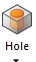

2. No **Hole Options**, configure:
   - tipo **Simple**  (primeiro botão);
   - **Standard:** ISO Metric; **Size:** **8** (a lista traz os diâmetros em mm);
   - **Hole extents:** **Through All**  (primeiro botão). O padrão do diálogo é o segundo botão, *Through Next*.

   Clique em **OK**.
3. Clique na **face superior exposta da base**. No esboço do furo, posicione o centro e cote **12 mm** até a borda X = 0 e **12 mm** até a borda Y = 0.
4. Clique em **Close Sketch**, confirme que a seta de remoção aponta para dentro da base e clique em **Finish**.

**Conferência:** o eixo do primeiro furo está em X = 12 e Y = 12. O recurso aparece como **Hole 1**.

### Etapa 4 — Distribuir os furos por padrão

1. Na guia **Home**, grupo **Pattern**, clique em **Pattern** . O mesmo botão faz padrões retangulares e circulares; o tipo é escolhido no painel.

   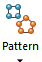

2. No painel, mantenha **Pattern Type: Rectangular**, clique em **Hole 1** (no modelo ou no PathFinder) e aceite (✓).

   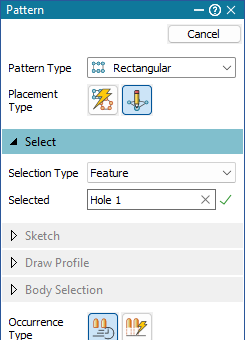

3. Clique na **face superior da base**. O Solid Edge abre um esboço com o painel **Rectangular Pattern**.
4. No painel, escolha o tipo **Fixed**  (terceiro botão) e configure:
   - **X:** **2** ocorrências, espaçamento **76 mm**;
   - **Y:** **2** ocorrências, espaçamento **36 mm**.
5. Clique no **centro do Hole 1** para o primeiro ponto e indique o sentido do padrão para dentro da base.
6. Clique em **Close Sketch** e depois em **Finish**.

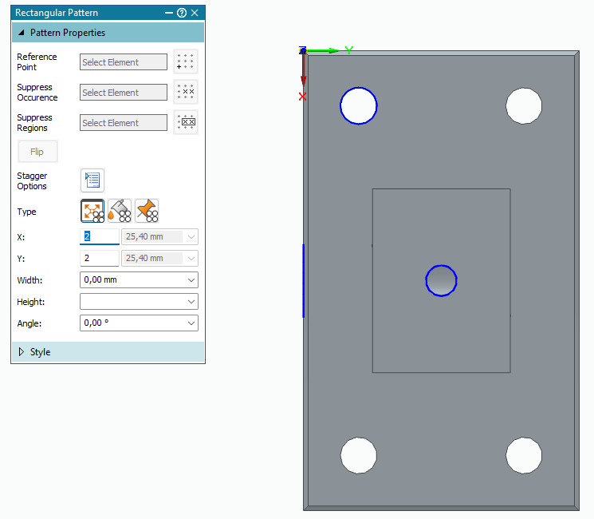

**Atenção à orientação:** a vista do esboço pode aparecer **girada**. Na reprodução, o eixo X local (seta vermelha) apontava para baixo, ao longo dos 100 mm. Associe **76 mm à direção dos 100 mm** e **36 mm à direção dos 60 mm**, seja qual for a posição na tela.

**Conferência:** a prévia deve mostrar quatro furos nas coordenadas da seção 1.2. Os três tipos do painel diferem na forma de informar a distância: **Fixed** usa o espaçamento entre centros; **Fit** usa a extensão total (*Width/Height*); **Fill** preenche uma região. Com duas posições por direção, espaçamento e extensão coincidem (76 e 36 mm).

### Etapa 5 — Criar o furo horizontal de Ø16 mm

1. Clique em **Hole**  › **Options** : tipo **Simple** , **Size 16**, extensão **Through All** . Clique em **OK**.
2. Selecione uma face vertical do ressalto com dimensões de **40 × 30 mm**, por exemplo a face situada em Y = 15.
3. Posicione o centro a **20 mm de uma borda lateral do ressalto** e a **15 mm de sua borda inferior**, situada sobre a base.
4. Clique em **Close Sketch**, oriente o furo para atravessar o ressalto ao longo de Y e clique em **Finish**.

**Conferência:** o furo atravessa 30 mm de material na direção Y. Seu eixo está em X = 50 e Z = 25, centralizado na face escolhida. O recurso aparece como **Hole 2**.

### Etapa 6 — Criar o furo roscado M8

1. Clique em **Hole**  › **Options**  e configure o **Hole Options** exatamente assim:
   - tipo **Threaded**  (segundo botão da primeira linha);
   - **Standard:** ISO Metric; **Sub type:** a rosca padrão (nesta instalação, "Rosca Padrão");
   - **Size:** **M8**. O item `M8` da lista é a rosca de **passo normal (1,25 mm)**; os itens com passo explícito logo abaixo, como `M8 x 1`, são passos finos e **não** devem ser usados;
   - **Hole extents:** **Finite Extent**  (quarto botão) e **Hole depth: 10 mm**;
   - na seção **Threads**, em **Thread extent**, marque **To hole extent**. O padrão é *Finite extent* com apenas **2,00 mm** de rosca;
   - confira **Pitch: 1,25 mm**.

   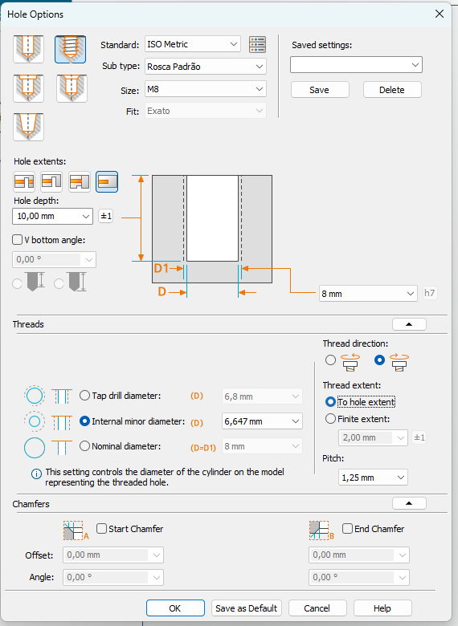

2. Clique em **OK** e selecione a **face superior do ressalto**.
3. Posicione o centro a **20 mm de uma borda na direção X** e a **15 mm de uma borda na direção Y**. Isso corresponde a X = 50 e Y = 30 na peça.
4. Clique em **Close Sketch**, confirme o sentido para baixo e clique em **Finish**. O recurso aparece como **Hole 3**.

**Conferência:** o furo começa em Z = 40 e seu fim nominal está em Z = 30. A abertura deve comunicar-se com o furo de Ø16 mm. Gire o modelo e inspecione essa comunicação pelo furo horizontal.

O cilindro modelado tem o **diâmetro menor da rosca (6,647 mm)**, conforme a opção *Internal minor diameter* da seção Threads. Com **V bottom angle** desmarcado (padrão), o fundo é plano; como o fim cai dentro do vazio do Ø16, isso não altera a geometria final.

Não substitua o recurso roscado por um furo simples de Ø8 mm. Utilize a definição M8 da tabela e preserve as informações de rosca para o desenho. A aparência gráfica representa a rosca de forma simplificada, sem espiras modeladas por Helix.

### Etapa 7 — Aplicar os chanfros

Uma escolha de referência para esta resolução é chanfrar **as quatro arestas do perímetro superior externo da base**, em Z = 10, com **1 × 45°**.

1. Na guia **Home**, abra o menu de **Round** e escolha **Chamfer** .

   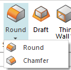

2. Em **Options**, mantenha **Equal Setbacks**  (primeiro botão), que equivale a 1 × 45°.
3. Em **Selection Type**, troque *Chain* por **Edge** e clique nas **quatro arestas externas** do topo da base.
4. Em **Setback**, digite **1 mm**. O valor padrão é **5,00 mm**.
5. Aceite (✓), confira a prévia e clique em **Finish**.

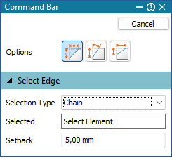

Essa seleção mantém as bocas dos furos e as arestas do ressalto sem chanfro. Outras escolhas são aceitas pelo enunciado, desde que registradas no desenho e sem prejuízo aos detalhes funcionais.

### Etapa 8 — Revisar o modelo e conferir o volume

1. Confira a árvore no **PathFinder**. Com esboços criados separadamente, como nesta resolução, a sequência é:

   ```text
   Sketch 1       Esboço da base 100 × 60
   Protrusion 1   Extrusão da base, 10 mm
   Sketch 2       Esboço do ressalto 40 × 30
   Protrusion 2   Extrusão do ressalto, 30 mm
   Hole 1         Ø8 passante (Through All)
   Pattern 1      Padrão retangular 2 × 2; espaçamentos 76 e 36
   Hole 2         Ø16 passante, horizontal
   Hole 3         M8 (passo 1,25); profundidade 10; rosca até o fim do furo
   Chamfer 1      1 × 45° no perímetro superior externo da base
   ```

   Se o perfil for desenhado dentro do próprio comando Extrude, os itens *Sketch* não aparecem; a sequência de recursos é a mesma.

2. Na guia **Inspect**, grupo **Physical Properties**, clique em **Properties**. O diálogo abre com os valores zerados (*"Physical Properties are out-of-date"*); clique em **Update** para calcular.

   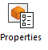

3. Compare o volume com os valores de referência, obtidos no modelo de referência:

   | Após o recurso | Volume (mm³) | Variação |
   |---|---:|---|
   | Protrusion 1 (base) | 60 000,0 | 100 × 60 × 10 |
   | Protrusion 2 (ressalto) | 96 000,0 | + 40 × 30 × 30 |
   | Hole 1 (Ø8) | 95 497,3 | − π·4²·10 |
   | Pattern 1 | 93 989,4 | − 3 furos de Ø8 |
   | Hole 2 (Ø16) | 87 957,5 | − π·8²·30 |
   | Hole 3 (M8) | 87 708,4 | − 249,1 (só o trecho em material) |
   | Chamfer 1 (peça final) | **87 549,8** | − 158,6 |

   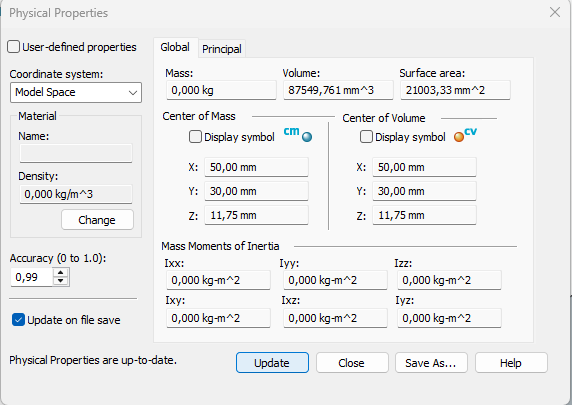

   O **centro de volume** deve estar em **X = 50 mm e Y = 30 mm**, o que confirma a centralização do ressalto e dos furos. A massa aparece como zero enquanto nenhum material for atribuído; isso não afeta a atividade.

4. Salve o arquivo.


