# Atividade 08 — Modelagem de cesto de lixo por transição de seções

**Disciplina:** Desenho Assistido por Computador (DAC)  
**Software:** Solid Edge 2023 (videoaula) — roteiro reproduzido e validado no Solid Edge 2026  
**Ambiente:** Part — modelagem Ordered  
**Tema:** Lofted Protrusion, Round, Thin Wall e aparência superficial

## 1. Objetivo

Construir um cesto de lixo tridimensional por transição entre dois perfis em planos paralelos, arredondar as arestas do fundo, produzir a cavidade por remoção de espessura (paredes finas) e aplicar uma aparência de madeira. Ao final, o estudante deverá reconhecer a função de cada recurso na árvore **PathFinder**.

## 2. Proposta de modelagem

O cesto tem **abertura circular** e **fundo hexagonal**, unidos por uma superfície lateral de transição (loft). Após o arredondamento das arestas do fundo, a face circular é removida por **Thin Wall**, gerando paredes de 2 mm.

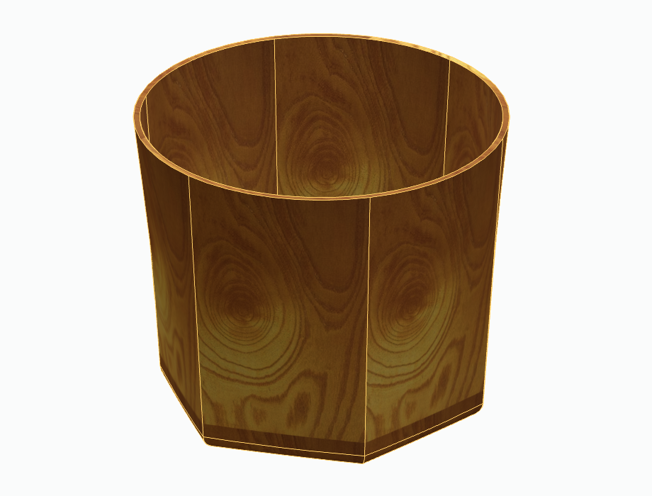

> **Atenção à orientação do modelo.** Na videoaula, o cesto é modelado **de cabeça para baixo**: o círculo (futura abertura) é desenhado no plano de base e o hexágono (futuro fundo) no plano deslocado 100 mm acima. Por isso a face removida no Thin Wall é a circular, embaixo. Para ver o cesto "em pé", basta girar a vista; a geometria não muda.

### 2.1 Tabela de dimensões e parâmetros

| Parâmetro | Valor / configuração | Observação técnica |
|---|---|---|
| Documento | Part (`.par`) | Ambiente de peça |
| Estratégia de modelagem | Ordered | Recursos sequenciais no PathFinder |
| Sketch 1 (plano Top) | Círculo **Ø120 mm** | Futura abertura do cesto |
| Plano de referência | Paralelo ao Top, a **100 mm** | Define a altura do cesto |
| Sketch 2 (plano deslocado) | Hexágono regular inscrito em **Ø106 mm** | Distância entre lados opostos = **91,79 mm** |
| Recurso de transição | Lofted Protrusion (aparece como *Protrusion 1*) | Seções: Sketch 1 → Sketch 2 |
| Arredondamento | Round **R5 mm** nas 6 arestas da face hexagonal | Suaviza a borda do fundo |
| Paredes finas | Thin Wall **2,00 mm**, *Offset Inside* | Face aberta: face circular |
| Acabamento | Aparência **Wood / Madeira** | Atributo visual, não altera a geometria |

> **Sobre o valor 91,79.** É a cota que aparece na videoaula ao dimensionar o hexágono. Ela corresponde à distância entre lados opostos de um hexágono inscrito em uma circunferência de Ø106 mm, pois 106 × cos 30° = 91,79 mm. Portanto, cotar o hexágono por **91,79 entre lados** ou pelo **Ø106 da circunferência de construção** produz o mesmo perfil.
>
> **Sobre o Ø120.** A videoaula não mostra a cota do círculo. O valor Ø120 mm foi adotado na reprodução a partir da proporção visível na tela e resulta em um modelo visualmente idêntico ao do vídeo. Se o docente indicar outro valor, utilize-o.

## 3. Procedimento experimental

### Etapa 1 — Preparar o arquivo de peça

1. Inicie o **Solid Edge** e crie um documento **Part** (modelo ISO métrico, unidade mm).
2. Confirme, no topo do **PathFinder**, que o ambiente está em **Ordered**. Se estiver em *Synchronous*, clique com o botão direito no ambiente e altere para *Ordered*.
3. Exiba os planos de referência (**Base Reference Planes**) clicando no ícone de olho no PathFinder.

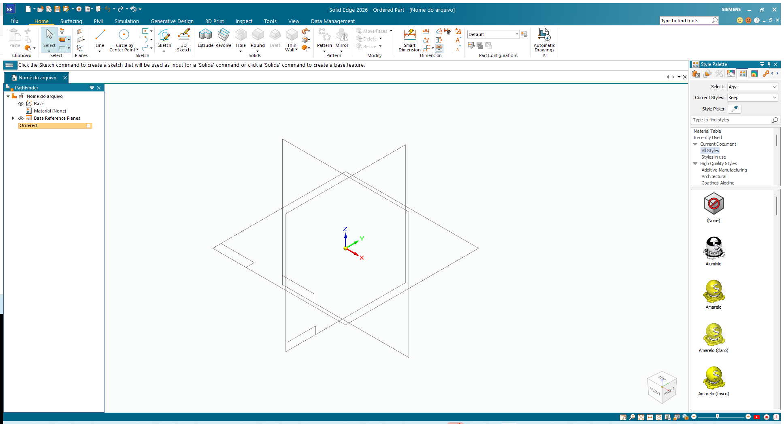

### Etapa 2 — Sketch 1: círculo da abertura

1. Na guia **Home**, clique em **Sketch** e selecione o plano **Top (xy)**, na área gráfica ou em *Base Reference Planes* no PathFinder.

   

2. Use **Circle by Center Point** e desenhe um círculo com centro na **origem**.

   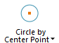

3. Cote com **Smart Dimension**: diâmetro **120 mm**.

   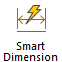

4. Clique em **Close Sketch**.

   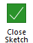

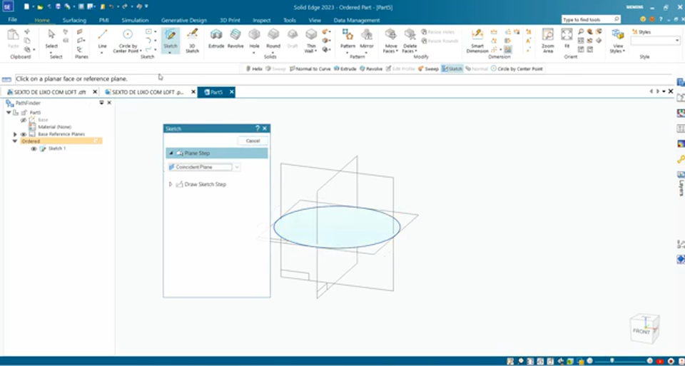

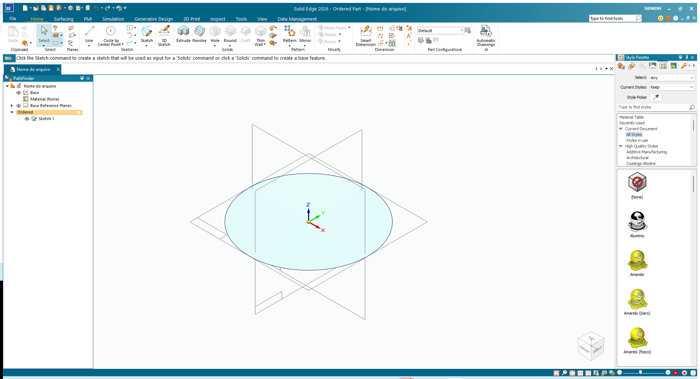

**Verificação:** o perfil precisa estar **fechado** e centrado na origem para servir de seção do loft.

### Etapa 3 — Plano paralelo a 100 mm

1. Na guia **Home**, grupo **Planes**, clique em **More Planes**  (segundo botão pequeno do grupo) e escolha **Parallel** .

   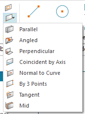

2. Selecione o plano **Top (xy)**.
3. Digite a distância **100 mm** e clique no lado **acima** do plano (sentido +Z).
4. O novo plano aparece no PathFinder como **Plane 4**.

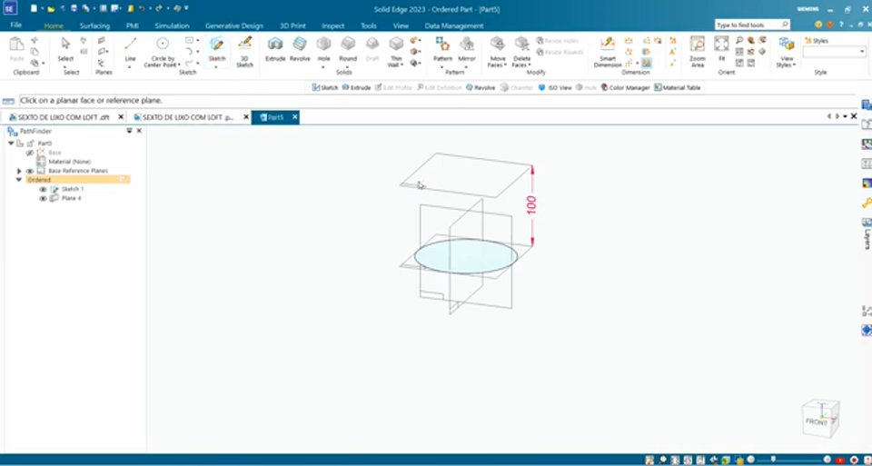

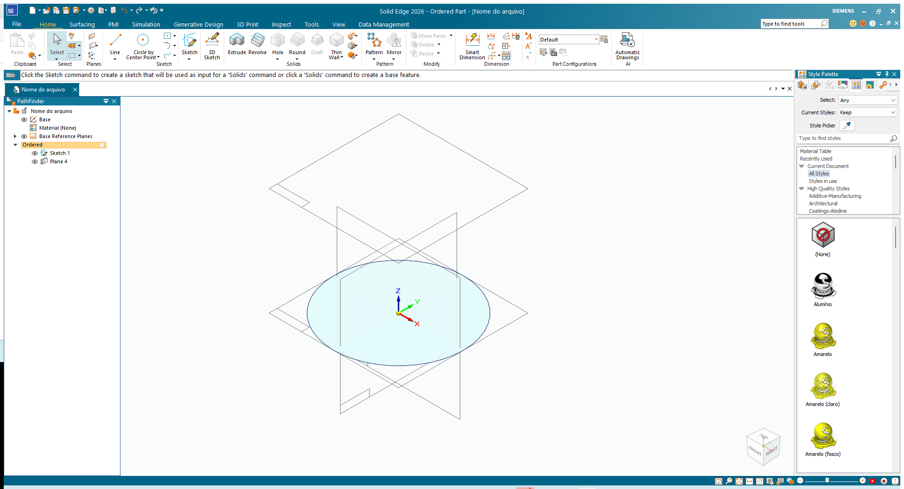

**Conceito:** a distância entre os planos dos dois perfis define a altura do cesto (100 mm).

### Etapa 4 — Sketch 2: hexágono do fundo

1. Clique em **Sketch**  e selecione o **Plane 4**.
2. No grupo **Draw**, abra o menu do retângulo  e escolha **Polygon by Center** . Configure **6 lados**, centro na **origem** e um vértice sobre o eixo **X**. Os lados superior e inferior ficam horizontais.

   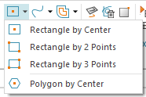

3. Cote com **Smart Dimension**  a distância entre os lados horizontais: **91,79 mm** (ou o Ø106 mm da circunferência de construção).
4. Clique em **Close Sketch** .

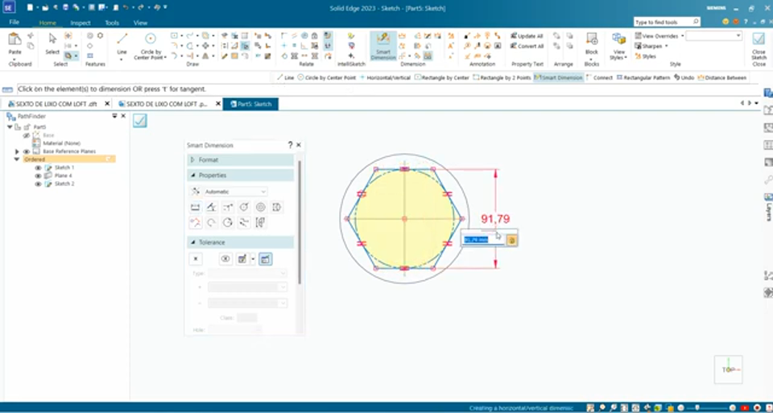

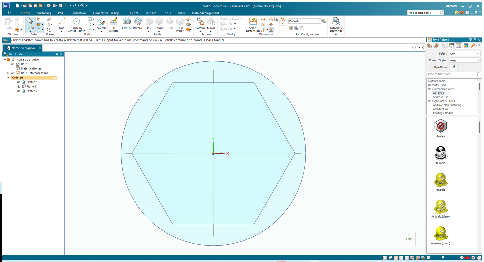

**Atenção:** o hexágono deve estar **concêntrico** ao círculo. Um deslocamento entre os centros produz um cesto inclinado.

### Etapa 5 — Lofted Protrusion (transição)

1. Na guia **Home**, grupo **Solids**, abra o menu **Add** , o botão pequeno à direita de **Thin Wall**, e escolha **Loft**  (*Lofted Protrusion*).

   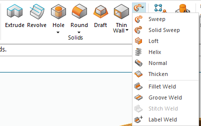

2. No painel, na etapa **Cross Section**, mantenha *Create From: Select from Sketch*.
3. Clique no **círculo (Sketch 1)** e aceite (✔). Em seguida clique no **hexágono (Sketch 2)** e aceite.
4. Confira os **pontos de início** destacados em cada seção: ambos devem estar do mesmo lado, por exemplo sobre o eixo **+X**. Pontos desalinhados provocam torção da superfície lateral.
5. Clique em **Preview** e depois em **Finish**.

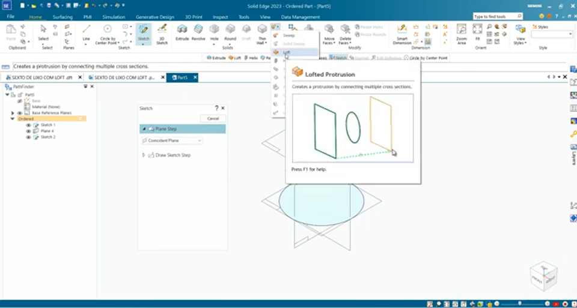

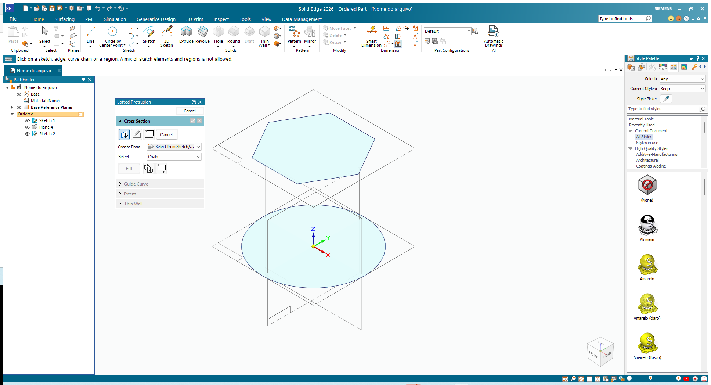

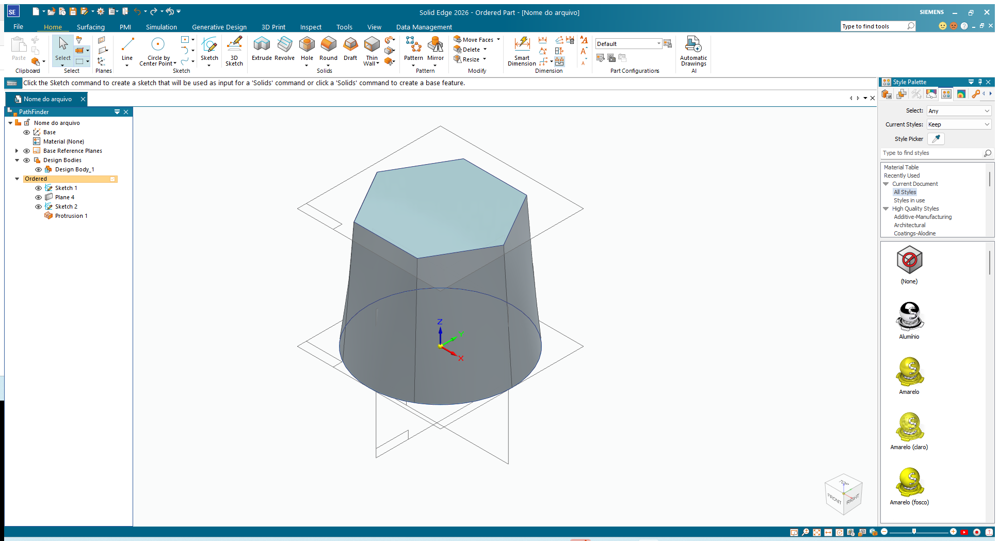

**Diagnóstico:** uma transição torcida ou "enrugada" indica ordem de seleção trocada, pontos de início desalinhados ou perfis não concêntricos.

> No PathFinder, o loft aparece como **Protrusion 1**, e não como "Lofted Protrusion".

### Etapa 6 — Round nas arestas do fundo

1. Na guia **Home**, clique em **Round**.

   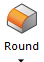

2. Em **Select**, mantenha *Edge/Corner* e clique nas **6 arestas da face hexagonal** (topo do sólido nesta orientação).
3. Digite o raio **5 mm** e aceite.
4. Clique em **Preview** e **Finish**. O recurso aparece como **Round 1**.

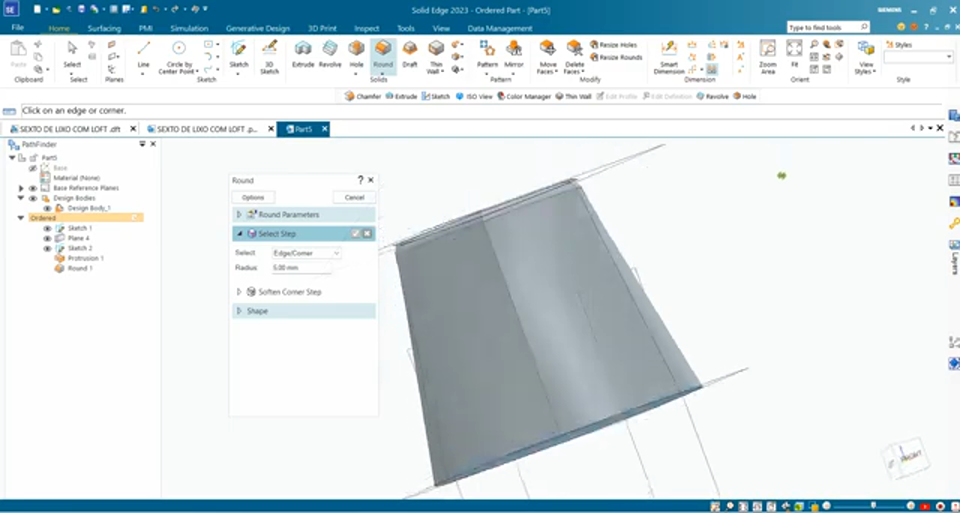

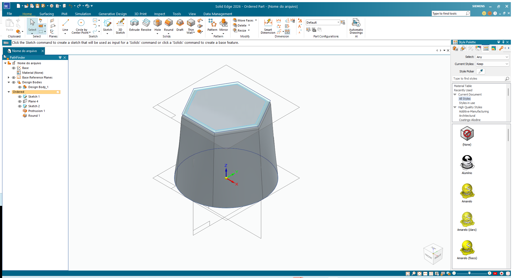

**Por que antes do Thin Wall?** Arredondando primeiro, o Thin Wall acompanha o arredondamento e gera cantos suaves por dentro e por fora.

### Etapa 7 — Thin Wall: paredes finas e abertura

1. Gire a vista para enxergar a **face circular** (embaixo).
2. Na guia **Home**, clique em **Thin Wall**.

   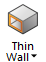

3. Na etapa **Common Thickness**, selecione **Offset Inside** (botão do meio) e digite **2,00 mm**.
4. Na etapa **Open Faces**, clique na **face circular** e aceite.
5. Clique em **Preview** e **Finish**. O recurso aparece como **Thin-Wall 1**.

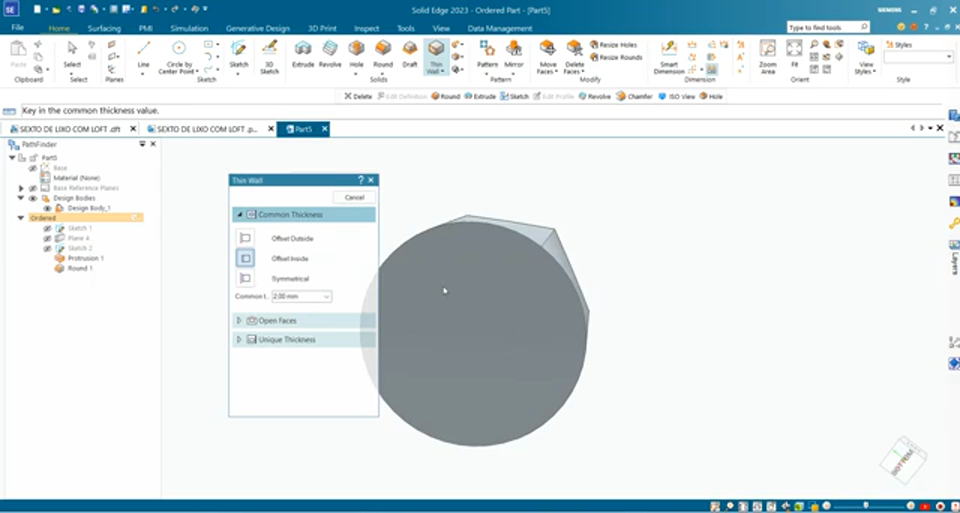

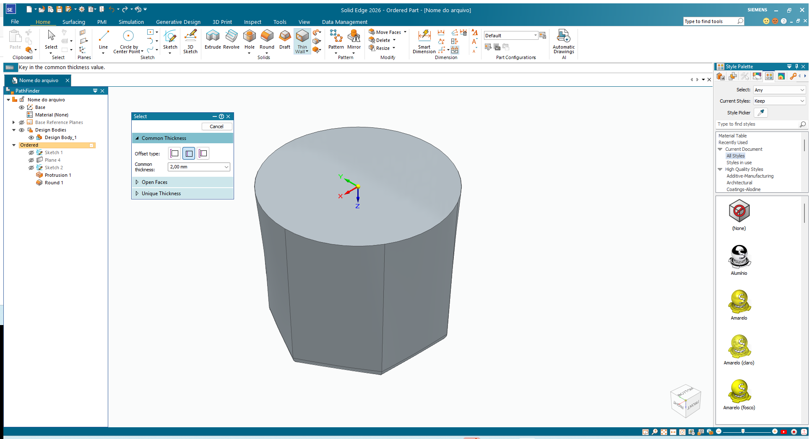

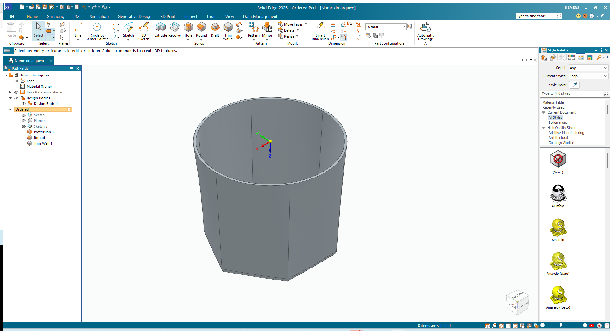

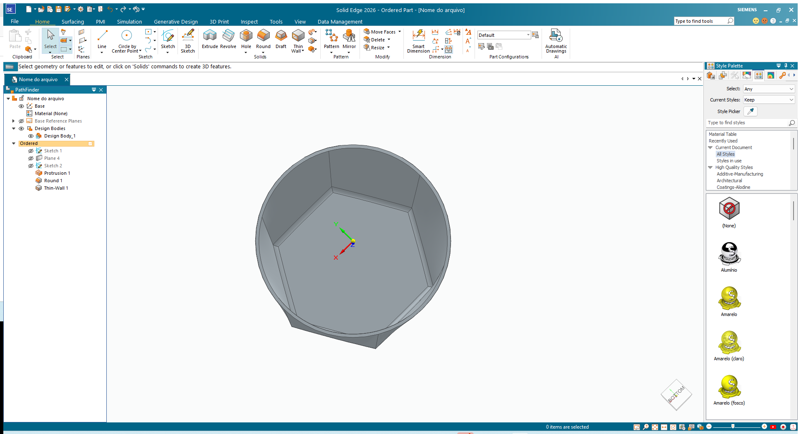

**Conceito:** com **Offset Inside**, a espessura é retirada **para dentro**, e as dimensões externas (Ø120, altura 100) permanecem. A face selecionada em *Open Faces* é removida e forma a abertura. A espessura não deve ser confundida com o diâmetro do recipiente.

### Etapa 8 — Aparência de madeira

1. Na guia **View**, grupo **Style**, clique em **Part Painter** .

   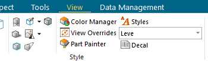

   - No Solid Edge 2026, uma mensagem recomenda usar a **Style Palette**. Responda **No** para continuar no Part Painter, ou **Yes** e arraste o estilo de madeira da paleta sobre a peça.
2. Em **Style**, escolha **Wood** (no modelo em português: **Madeira**). Em **Select**, mantenha **Any**.
3. Clique sobre a peça e depois em **Close**.
4. Gire a vista para inspecionar a parte interna e o fundo.

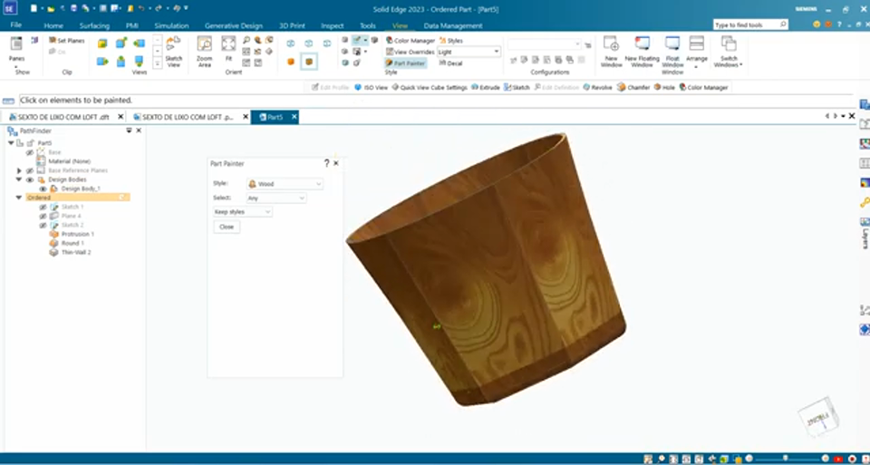

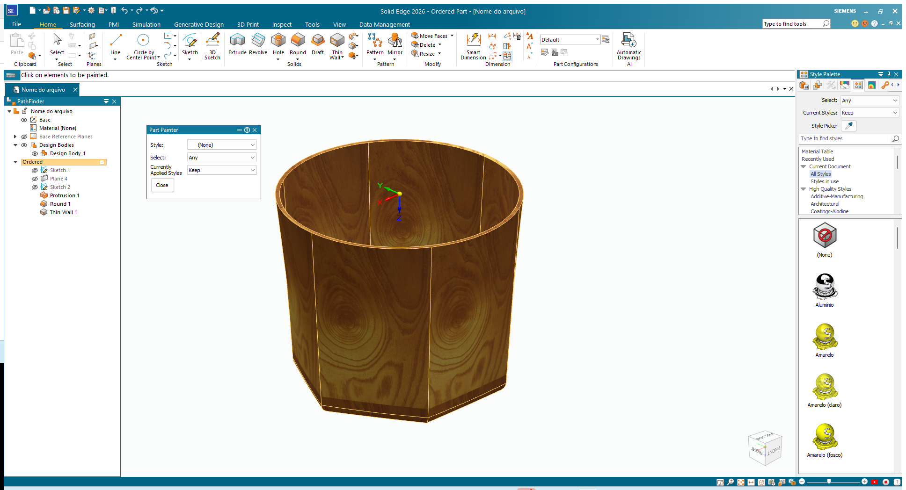

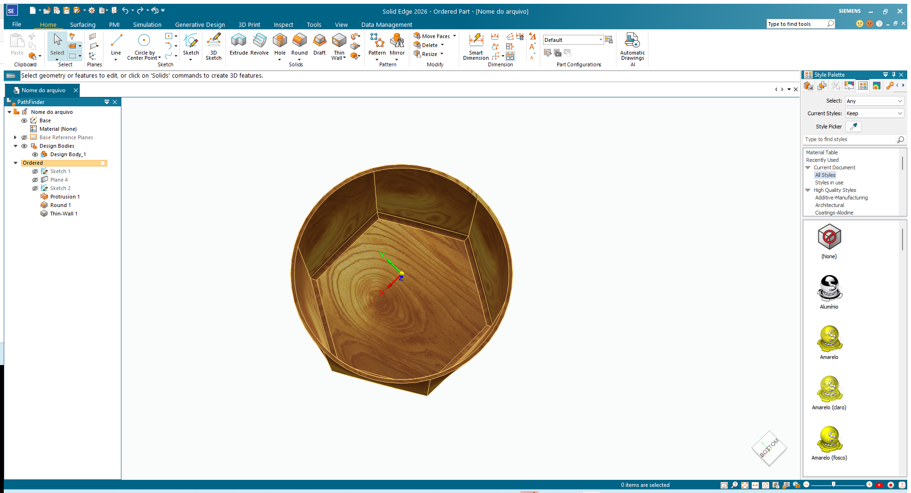

**Importante:** a aparência é um atributo **visual**. Não altera densidade, massa nem o material físico atribuído (*Material (None)* continua no PathFinder).

### Etapa 9 — Conferência e salvamento

1. Confira o **PathFinder**. A sequência esperada é:

   ```
   Ordered
   ├── Sketch 1        (círculo Ø120)
   ├── Plane 4         (paralelo ao Top, 100 mm)
   ├── Sketch 2        (hexágono, 91,79 entre lados)
   ├── Protrusion 1    (Lofted Protrusion)
   ├── Round 1         (R5, arestas do hexágono)
   └── Thin-Wall 1     (2 mm, Offset Inside, face circular aberta)
   ```

2. *(Opcional)* Em **Inspect → Physical Properties**, compare o volume com os valores de referência da reprodução:

   | Após o recurso | Volume aproximado |
   |---|---|
   | Protrusion 1 (loft maciço) | 923 921 mm³ |
   | Round 1 | 922 651 mm³ |
   | Thin-Wall 1 (peça final) | 80 747 mm³ |

   Diferenças pequenas são normais entre versões do software. Uma diferença grande indica cota, espessura ou lado do offset diferente.

3. Salve com **Save** no formato nativo `.par`, por exemplo: `DAC_Aula20_Cesto_Loft_ThinWall.par`.

## 4. Resultado esperado

Um cesto de lixo com abertura circular Ø120 mm, fundo hexagonal com arestas arredondadas (R5), altura de 100 mm, superfície lateral de transição por **Lofted Protrusion**, paredes de 2 mm geradas por **Thin Wall** com o fundo preservado, e aparência de madeira.


Um modelo de referência gerado no Solid Edge 2026 está em [`modelo/DAC_Aula20_Cesto_Loft_ThinWall.par`](./modelo/DAC_Aula20_Cesto_Loft_ThinWall.par).

> **Compatibilidade:** arquivos `.par` salvos no Solid Edge 2026 **não abrem** em versões anteriores, como o Solid Edge 2023. Nesse caso, siga o roteiro para reconstruir a peça.

## 5. Exercício proposto — Vaso / porta-lápis com três seções

Aplique os mesmos recursos da aula para modelar o vaso abaixo. A diferença em relação ao cesto é que o loft passa por **três seções**: base quadrada, barriga circular e boca circular. Desta vez o modelo é construído **em pé**, com a base no plano Top.

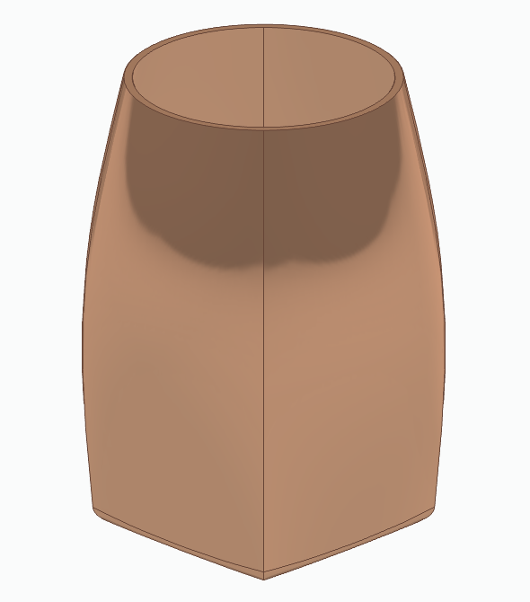

### 5.1 Dados

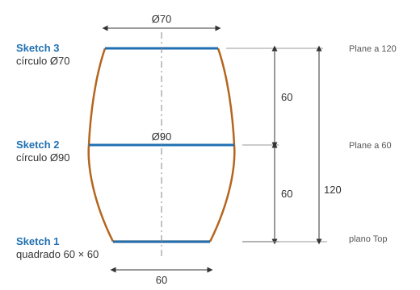

| Elemento | Valor |
|---|---|
| Sketch 1 (plano Top) | Quadrado **60 × 60 mm**, centrado na origem |
| Plano 1 | Paralelo ao Top, a **60 mm** |
| Sketch 2 | Círculo **Ø90 mm**, centrado |
| Plano 2 | Paralelo ao Top, a **120 mm** |
| Sketch 3 | Círculo **Ø70 mm**, centrado (boca do vaso) |
| Loft | Seções na ordem Sketch 1 → Sketch 2 → Sketch 3 |
| Round | **R4 mm** nas 4 arestas da base quadrada |
| Thin Wall | **2 mm**, *Offset Inside*, face aberta: **boca Ø70** |
| Aparência | À escolha (sugestão: **Copper / Cobre**) |

### 5.2 Orientações

- O quadrado pode ser desenhado com **Rectangle by Center** (no mesmo menu do Polygon by Center), com centro na origem.
- No **Loft**, selecione as três seções em sequência, **de baixo para cima**, e só depois clique em **Preview**.
- Alinhe os pontos de início: no quadrado, use um **vértice**; nos círculos, o ponto **mais próximo desse vértice**. Pontos desalinhados torcem as faces laterais.
- No **Thin Wall**, a face aberta agora é a de **cima** (boca), porque o vaso foi modelado em pé.

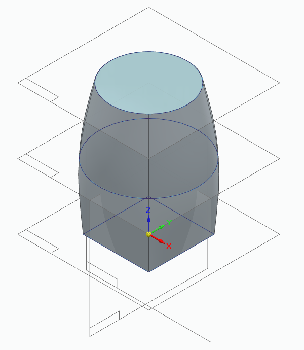

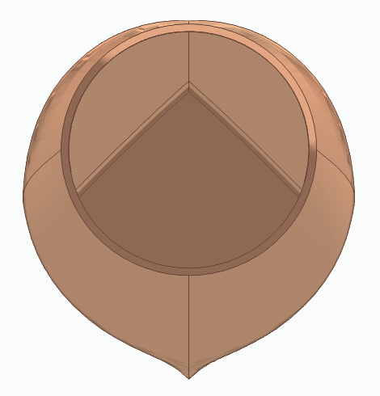

### 5.3 Conferência

A árvore do PathFinder deve ficar assim:

```
Ordered
├── Sketch 1        (quadrado 60 × 60)
├── Plane 4         (60 mm)
├── Sketch 2        (círculo Ø90)
├── Plane 5         (120 mm)
├── Sketch 3        (círculo Ø70)
├── Protrusion 1    (loft com 3 seções)
├── Round 1         (R4, base)
└── Thin-Wall 1     (2 mm, boca aberta)
```

Em **Inspect → Physical Properties**, os volumes devem ficar próximos de:

| Após o recurso | Volume aproximado |
|---|---|
| Protrusion 1 | 639 768 mm³ |
| Round 1 | 639 355 mm³ |
| Thin-Wall 1 (peça final) | 68 421 mm³ |

### 5.4 Entrega

1. Arquivo `DAC_Aula08_Exercicio_<seu_nome>.par`.
2. Volume final obtido em *Physical Properties*.
3. Respostas curtas:
   - Por que, no vaso, a face aberta no Thin Wall é a de cima, e no cesto da aula era a de baixo?
   - O que acontece com a forma do vaso se o loft for feito só com o Sketch 1 e o Sketch 3, sem a seção do meio?
